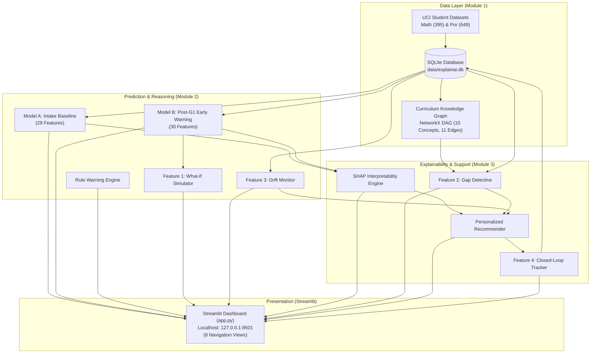

# ExplainAI: An Explainable AI-Based Student Performance Prediction and Personalized Learning Support System for Inclusive and Quality Education

[](https://www.python.org/downloads/)
[](docs/final_test_report.md)
[](https://streamlit.io/)
[](https://github.com/slundberg/shap)
[](#)

---

## 1. Executive Summary & Problem Statement

Academic failure in secondary education carries severe consequences for student progression, institutional retention, and socioeconomic equity. Conventional early-warning systems often function as uninterpretable "black boxes" that output raw risk scores without actionable explanations or pedagogically grounded remediation paths.

**ExplainAI** addresses this challenge by fusing **predictive machine learning**, **game-theoretic explainability (SHAP)**, **formal curricular knowledge graphs (DAGs)**, and a **closed-loop intervention tracking system**. It enables educators to:
1. Detect academic failure risk at intake and post-first period assessment ($G1$).
2. Decompose individual student risk into transparent, localized factor contributions.
3. Trace prerequisite knowledge gaps to identify foundational learning deficiencies.
4. Test hypothetical intervention levers before real-world implementation.
5. Prescribe, verify, and track evidence-based learning remediations through to mastery.

---

## 2. Core Architecture: Exactly Three Modules

ExplainAI is structured into **exactly three functional modules**:

```
ExplainAI Platform
├── Module 1: Knowledge Representation and Data Processing
│   ├── UCI Ingestion & Multi-Subject Cohort Isolation (1,044 Records)
│   ├── Relational SQLite Database & Date Provenance System
│   └── Curricular Knowledge Graph (NetworkX Directed Acyclic Graphs)
│
├── Module 2: Prediction and Rule-Based Reasoning
│   ├── Dual-Experiment ML Pipelines (Model A: 29 Features, Model B: 30 Features)
│   ├── Heuristic Warning Engine
│   ├── 🔮 Signature Feature 1: Academic What-If Simulator
│   └── 📉 Signature Feature 3: Academic Drift Early-Warning System
│
└── Module 3: Explainable AI and Personalized Support
    ├── Local & Global SHAP Feature Interpretability (Log-Odds Scale)
    ├── 🧩 Signature Feature 2: Prerequisite-Aware Knowledge Gap Detective
    ├── Personalized Evidence-Based Learning Recommender
    ├── 🔄 Signature Feature 4: Closed-Loop Learning Improvement Tracker
    └── Integrated 8-View Streamlit Web Dashboard
```

---

## 3. Four Signature Features

ExplainAI delivers four signature capabilities:

| Feature | Name | Module | Description |
|---|---|---|---|
| **Feature 1** | **Academic What-If Simulator** | Module 2 | Interactive counterfactual scenario engine allowing educators to adjust validated academic levers (`studytime`, `freetime`, `goout`, `schoolsup`, `famsup`, `paid`) to assess statistical risk delta while strictly rejecting immutable demographics, health/substances, and historical grades. Includes an explicit causal disclaimer. |
| **Feature 2** | **Prerequisite-Aware Knowledge Gap Detective** | Module 3 | Curricular DAG analysis engine that performs reverse topological traversal to identify root prerequisite concept failures, accurately distinguishing confirmed failed prerequisites from unassessed concepts. |
| **Feature 3** | **Academic Drift Early-Warning System** | Module 2 | Longitudinal performance trajectory monitor tracking score deltas between Term 1 ($G1$) and Term 2 ($G2$), categorizing trajectories into Severe Drift, Moderate Drift, Stable, and Improving. |
| **Feature 4** | **Closed-Loop Learning Improvement Tracker** | Module 3 | Actionable pedagogical remediation workflow that assigns targeted interventions, administers interactive diagnostic post-quizzes, verifies mastery improvement, and updates the student's mastery profile. |

---

## 4. System Architecture Diagram



---

## 5. Technology Stack

- **Core Runtime**: Python 3.13.12
- **Web Dashboard**: Streamlit 1.40.0 (Custom modern CSS, card layouts, responsive sidebar)
- **Machine Learning**: Scikit-Learn 1.5.2, XGBoost 3.3.0, Joblib 1.5.3
- **Explainable AI (XAI)**: SHAP 0.54.1 (`TreeExplainer`, `LinearExplainer`)
- **Knowledge Representation**: NetworkX 3.6.1 (Directed Acyclic Graphs, topological sorting)
- **Data & Visualization**: Pandas 2.2.3, NumPy 2.1.3, Plotly 6.9.0
- **Database Engine**: SQLite 3 (WAL mode, foreign key cascades, atomic transactions)
- **Quality Assurance**: Pytest 9.1.1 (45 tests passing)
- **Browser Automation**: Playwright 1.61.0 (Full-fidelity dashboard screenshots)

---

## 6. Dataset & Provenance Integrity

- **Origin**: UCI Machine Learning Repository - *Student Performance Data Set* (Cortez & Silva, 2008).
- **Cohort Composition**: 
  - Mathematics: 395 student course records (`student-mat.csv`).
  - Portuguese Language: 649 student course records (`student-por.csv`).
  - Total records: 1,044 course enrollment records across both cohorts.
- **Cross-Subject Matching Analysis**:
  - Merging on the 13 demographic attributes specified in `student-merge.R` yields 382 merged rows.
  - However, detailed empirical matching analysis demonstrates that these 382 merged rows do **not** establish 382 unique cross-enrolled people.
  - Specifically, the matching produces:
    - **358 unambiguous 1-to-1 matching keys**.
    - **8 ambiguous keys** that appear multiple times in the cohorts.
    - **24 Cartesian product rows** generated by those 8 ambiguous keys ($358 + 24 = 382$).
    - A total of **366 distinct matching-key combinations** (explicitly noting that these are distinct matching-key combinations, not verified unique individuals).
  - Consequently, course records for Mathematics and Portuguese are preserved as isolated cohorts in the database to prevent duplicate identity conflation.
- **Assessment Structure**: Three sequential evaluations ($G1$, $G2$, $G3$) scored on a 0-20 scale. Binary at-risk label defined as $G3 < 10$.
- **Date Provenance**: The raw UCI dataset records term sequence order but provides **no authentic calendar dates**. The ExplainAI schema strictly sets `assessment_date = NULL` for all authentic UCI records and tags them with `date_provenance = 'NOT_PROVIDED_IN_UCI_SOURCE'` and `is_uci_source = 1` to prevent synthetic dates from being misrepresented as historical truth.
- **Absences Exclusion**: `absences` is recorded post-hoc as a full-year cumulative total in the raw dataset. To prevent temporal target leakage, `absences` is strictly excluded from all predictive models (Model A and Model B) and used solely for descriptive demographic profiling.

---

## 7. Machine Learning Models & Metric Verification

All candidate models were selected strictly using **Training-Only 5-Fold Stratified Cross-Validation** on an 80/20 train/test split (`random_state=42`) via the composite selection criterion:
$$\text{CV Selection Score} = (\text{Mean CV } F_1 \times 100) + \text{Mean CV Balanced Accuracy}$$
Held-out test sets were evaluated once solely for final unbiased reporting.

All values below are verified directly against `models/model_evaluation_metrics.json`:

| Experiment | Subject | Selected Algorithm | Actual Artifact Filename | CV Selection Score | Held-Out Test Balanced Acc | Held-Out Test $F_1$ | Held-Out Test ROC-AUC | Held-Out Test Confusion Matrix |
|---|---|---|---|---|---|---|---|---|
| **Model A (Intake)** | Mathematics | **Logistic Regression** | `mathematics_a_best.joblib` | **47.0203** | 0.6571 | 0.5574 | 0.7170 | `{"tn": 35, "fp": 18, "fn": 9, "tp": 17}` |
| **Model A (Intake)** | Portuguese | **Random Forest** | `portuguese_a_best.joblib` | **47.3169** | 0.7000 | 0.4878 | 0.7927 | `{"tn": 99, "fp": 11, "fn": 10, "tp": 10}` |
| **Model B (Post-G1)** | Mathematics | **Logistic Regression** | `mathematics_b_best.joblib` | **75.2302** | 0.8287 | 0.7586 | 0.9325 | `{"tn": 43, "fp": 10, "fn": 4, "tp": 22}` |
| **Model B (Post-G1)** | Portuguese | **XGBoost** | `portuguese_b_best.joblib` | **70.0814** | 0.8523 | 0.6415 | 0.9068 | `{"tn": 94, "fp": 16, "fn": 3, "tp": 17}` |

*(Note: While draft notes may have referenced shorthand prefixes like `math_a_best.joblib`, the verified, actual files in the filesystem and evaluation record are named `mathematics_a_best.joblib` and `mathematics_b_best.joblib`).*

---

## 8. Installation & Quick Start

### 8.1 Prerequisites
- Python 3.10+ installed (Python 3.13 recommended).
- Git.

### 8.2 Environment Setup
```bash
# 1. Clone repository & enter workspace
cd C:\Users\BAGYALAKSHMI\OneDrive\Desktop\KE

# 2. Create and activate a virtual environment (optional but recommended)
python -m venv venv
venv\Scripts\activate

# 3. Install dependencies
pip install -r requirements.txt
```

### 8.3 Run Automated Regression Tests
```bash
python -m pytest tests/ -v
```
*Expected result*: `45 passed, 14 warnings in ~15-25s`.

### 8.4 Launch the Streamlit Dashboard
```bash
python -m streamlit run app.py
```
Open your browser and navigate to:
```
http://127.0.0.1:8501
```

---

## 9. Dashboard Interface Navigation

The dashboard offers eight synchronized navigation views:

| # | View | Description | Screenshot Reference |
|---|---|---|---|
| 01 | **📊 Dashboard Overview** | Executive KPIs, student demographic matrix, G1-G3 trajectory plot, and heuristic alerts. | [docs/screenshots/01_dashboard_overview.png](docs/screenshots/01_dashboard_overview.png) |
| 02 | **🎯 Academic Prediction** | Model A vs Model B risk categories, probabilities, and rule-based diagnostic warning feed. | [docs/screenshots/02_academic_prediction.png](docs/screenshots/02_academic_prediction.png) |
| 03 | **🔍 SHAP Explainability** | Local feature contribution waterfall chart (log-odds margin scale) and global feature importance. | [docs/screenshots/03_shap_explainability.png](docs/screenshots/03_shap_explainability.png) |
| 04 | **🔮 What-If Simulator** | *Signature Feature 1*: Actionable scenario sliders with counterfactual probability delta and causal disclaimer. | [docs/screenshots/04_what_if_simulator.png](docs/screenshots/04_what_if_simulator.png) |
| 05 | **📉 Academic Drift Monitoring** | *Signature Feature 3*: G1 to G2 trajectory delta calculation and clinical drift classification. | [docs/screenshots/05_drift_monitoring.png](docs/screenshots/05_drift_monitoring.png) |
| 06 | **🧩 Knowledge Gap Detective** | *Signature Feature 2*: Curricular DAG visualization, root gap tracing, and unassessed node flagging. | [docs/screenshots/06_gap_detective.png](docs/screenshots/06_gap_detective.png) |
| 07 | **💡 Personalized Recommendations** | Triaged pedagogical guidance citing empirical SHAP, KG, and drift evidence bases. | [docs/screenshots/07_personalized_recommendations.png](docs/screenshots/07_personalized_recommendations.png) |
| 08 | **🔄 Improvement Tracker** | *Signature Feature 4*: Prescribed intervention management, interactive diagnostic quizzes, and closed-loop mastery updates. | [docs/screenshots/08_improvement_tracker.png](docs/screenshots/08_improvement_tracker.png) |

---

## 10. Complete Documentation Index

- [System Architecture](docs/system_architecture.md): Deep architectural breakdown, data pipelines, and security model.
- [Database Schema](docs/database_schema.md): Complete relational schema, constraints, ERD, and provenance policies.
- [Demonstration Script](docs/demo_script.md): Step-by-step evaluator walkthrough and test procedures.
- [Final Test Report](docs/final_test_report.md): Execution logs and verification for all 45 automated test cases.
- [Screenshot Inventory](docs/screenshots/README.md): Genuine screenshots of all 8 interface views.
- [Module 1 Technical Report](docs/module1_report.md): Data ingestion, schema validation, unfitted preprocessor pipelines, and curriculum DAG modeling.
- [Module 2 Technical Report](docs/module2_report.md): ML model training, selection policy, rule engine, What-If simulator, and drift monitoring.
- [Module 3 Technical Report](docs/module3_report.md): SHAP explainability, gap detective, recommender, and closed-loop improvement tracking.

---

## 11. Scientific Limitations & Ethical Disclosures

1. **Capstone Research Prototype**:
   ExplainAI is an academic capstone prototype developed for educational intelligence research. It is not licensed as an autonomous administrative decision-making system.
2. **Associative vs Causal Relationships**:
   All SHAP attributions and What-If simulator projections reflect associative statistical correlations captured by machine learning models on observational data. They do not constitute guaranteed causal outcomes.
3. **Absences Exclusion**:
   Absences were omitted from model feature spaces to prevent retrospective target leakage. In practical deployments, attendance should be monitored longitudinally as period-specific rates.
4. **Curricular Construct Provenance**:
   The curricular concepts and diagnostic questions are expert-crafted demonstration constructs designed to illustrate knowledge graph reasoning. Real-world institutional deployment requires curriculum mapping by domain educators.
5. **Statistical Uncertainty**:
   Model predictions provide probability estimates from the fitted classifiers. These outputs have not been independently calibrated, and no confidence intervals are provided.
