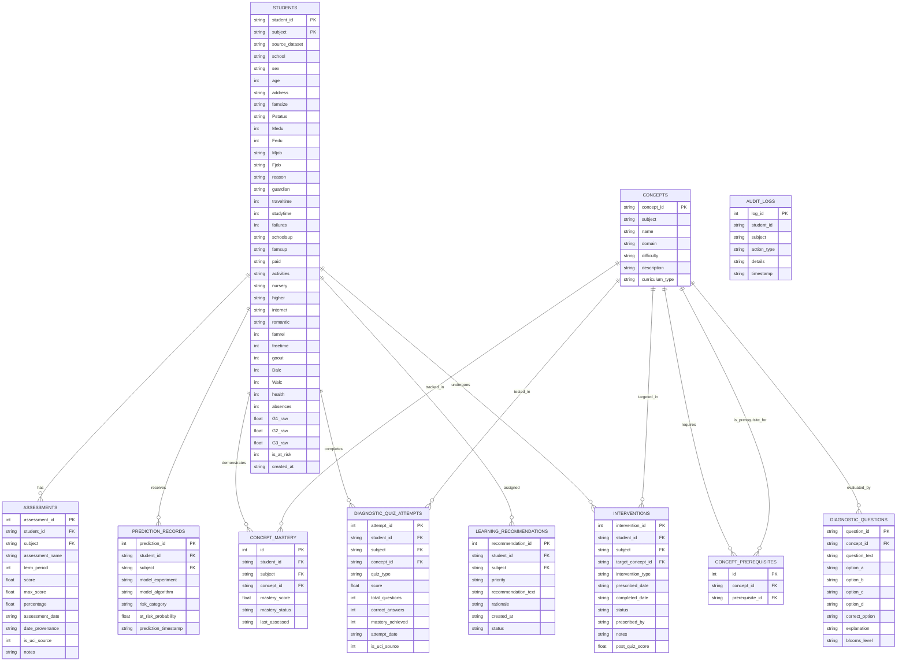

# ExplainAI: An Explainable AI-Based Student Performance Prediction and Personalized Learning Support System for Inclusive and Quality Education

This document provides a comprehensive technical reference for the relational database schema supporting **ExplainAI: An Explainable AI-Based Student Performance Prediction and Personalized Learning Support System for Inclusive and Quality Education**.

---

## 1. Database Overview

- **RDBMS Engine**: SQLite 3 (WAL mode supported, foreign key constraints strictly enforced via `PRAGMA foreign_keys = ON;`).
- **Database File**: `data/explainai.db`
- **Architectural Scope**: Multi-subject isolation across secondary school **Mathematics** (`data/raw/student-mat.csv`) and **Portuguese Language** (`data/raw/student-por.csv`) cohorts, curriculum knowledge graphs, diagnostic assessments, ML prediction logs, personalized learning recommendations, and intervention tracking.

---

## 2. Entity-Relationship Diagram (ERD)

---

## 3. Table Catalog & Column Specifications

### 3.1 `students`
Primary repository of student demographic, socioeconomic, academic background, and raw term performance.
- **Primary Key**: `(student_id, subject)` (Composite key ensuring subject cohort isolation).
- **Row Count**: 1,044 records (395 Mathematics, 649 Portuguese).
- **Key Columns**:
  - `student_id` (`TEXT`, NOT NULL): Identifier formatted as `MAT_001`..`MAT_395` or `POR_001`..`POR_649`.
  - `subject` (`TEXT`, NOT NULL): `'Mathematics'` or `'Portuguese'`.
  - `source_dataset` (`TEXT`, NOT NULL): Originating raw CSV filename.
  - Demographic & Family: `school`, `sex`, `age`, `address`, `famsize`, `Pstatus`, `Medu`, `Fedu`, `Mjob`, `Fjob`, `reason`, `guardian`.
  - Academic & Study Habits: `traveltime`, `studytime`, `failures`, `schoolsup`, `famsup`, `paid`, `activities`, `nursery`, `higher`, `internet`, `romantic`.
  - Social & Health Habits: `famrel`, `freetime`, `goout`, `Dalc`, `Walc`, `health`, `absences`.
  - Raw Term Grades: `G1_raw`, `G2_raw`, `G3_raw` (`REAL`, scale 0-20).
  - Ground-Truth Target: `is_at_risk` (`INTEGER`, binary: 1 if `G3_raw < 10`, else 0).
  - `created_at` (`TEXT`, NOT NULL): ISO 8601 creation timestamp.

### 3.2 `assessments`
Longitudinal record of term assessments and quiz evaluations.
- **Primary Key**: `assessment_id` (`INTEGER AUTOINCREMENT`).
- **Foreign Keys**: `(student_id, subject)` references `students(student_id, subject)`.
- **Row Count**: 3,132 records (exactly 3 per student record: G1, G2, G3).
- **Key Columns**:
  - `term_period` (`INTEGER`, NOT NULL): Ordered term sequence: `1` (First Period), `2` (Second Period), `3` (Final Examination).
  - `score` (`REAL`, NOT NULL): Raw grade (0-20).
  - `max_score` (`REAL`, NOT NULL): Fixed at 20.0.
  - `percentage` (`REAL`, NOT NULL): Calculated percentage (`score / max_score * 100`).
  - `assessment_date` (`TEXT`, NULL): Calendar date. Set to `NULL` for genuine UCI records because UCI dataset provides term period order but no authentic calendar dates.
  - `date_provenance` (`TEXT`, NOT NULL): Provenance audit flag: `'NOT_PROVIDED_IN_UCI_SOURCE'` for genuine UCI grades, `'ESTIMATED_DEMONSTRATION'` for synthetic demonstration records, or `'VERIFIED_USER_ENTERED'` for verified user entries.
  - `is_uci_source` (`INTEGER`, NOT NULL): `1` for authentic UCI dataset records, `0` for application-generated records.

### 3.3 `concepts`
Curriculum topics and learning objectives structured into domain hierarchies.
- **Primary Key**: `concept_id` (`TEXT`).
- **Row Count**: 10 records (5 Mathematics, 5 Portuguese).
- **Key Columns**:
  - `concept_id`: E.g., `MATH_ALG_01`, `MATH_ALG_02`, `PORT_GRAM_01`.
  - `subject`: Subject area.
  - `name`: Human-readable title (e.g., "Linear Equations & Inequalities").
  - `domain`: Subject domain (e.g., "Algebra", "Calculus", "Morphosyntax", "Literature").
  - `difficulty`: Pedagogical difficulty tier (`'Foundational'`, `'Intermediate'`, `'Advanced'`).
  - `description`: Formal conceptual summary.
  - `curriculum_type` (`TEXT`, NOT NULL): Explicitly designated as `'demonstration_curriculum'` to reflect expert-crafted capstone demonstration alignment.

### 3.4 `concept_prerequisites`
Directed acyclic graph (DAG) edges representing prerequisite dependency relationships.
- **Primary Key**: `id` (`INTEGER AUTOINCREMENT`).
- **Foreign Keys**:
  - `concept_id` references `concepts(concept_id)`.
  - `prerequisite_id` references `concepts(concept_id)`.
- **Row Count**: 11 dependency edges across mathematics and language domains.
- **Integrity Guarantee**: Directed Acyclic Graph topology strictly verified via NetworkX (`nx.is_directed_acyclic_graph(G) == True`).

### 3.5 `diagnostic_questions`
Diagnostic multiple-choice items mapped to curriculum concepts.
- **Primary Key**: `question_id` (`TEXT`).
- **Foreign Key**: `concept_id` references `concepts(concept_id)`.
- **Row Count**: 20 items (exactly 2 questions per concept).
- **Columns**: `question_text`, `option_a`, `option_b`, `option_c`, `option_d`, `correct_option`, `explanation`, `blooms_level` (`'Remember'`, `'Understand'`, `'Apply'`, `'Analyze'`).

### 3.6 `diagnostic_quiz_attempts`
Logs of student submissions on diagnostic concept quizzes.
- **Primary Key**: `attempt_id` (`INTEGER AUTOINCREMENT`).
- **Foreign Keys**: `(student_id, subject)` references `students(student_id, subject)`, `concept_id` references `concepts(concept_id)`.
- **Columns**: `quiz_type` (`'baseline'`, `'post_intervention'`), `score`, `total_questions`, `correct_answers`, `mastery_achieved` (0 or 1), `attempt_date`, `is_uci_source` (always `0`).

### 3.7 `concept_mastery`
Current mastery state of a student for each concept.
- **Primary Key**: `id` (`INTEGER AUTOINCREMENT`).
- **Foreign Keys**: `(student_id, subject)` references `students(student_id, subject)`, `concept_id` references `concepts(concept_id)`.
- **Columns**: `mastery_score` (0.0 to 1.0), `mastery_status` (`'Mastered'`, `'Developing'`, `'Needs Remediation'`), `last_assessed` (ISO timestamp).

### 3.8 `prediction_records`
Audit trail of ML risk predictions generated during application usage.
- **Primary Key**: `prediction_id` (`INTEGER AUTOINCREMENT`).
- **Foreign Keys**: `(student_id, subject)` references `students(student_id, subject)`.
- **Columns**: `model_experiment` (`'MODEL_A'`, `'MODEL_B'`), `model_algorithm` (`'LogisticRegression'`, `'RandomForest'`, `'XGBoost'`), `risk_category` (`'Low Risk'`, `'Moderate Risk'`, `'High Risk'`), `at_risk_probability` (0.0 to 1.0), `prediction_timestamp`.

### 3.9 `learning_recommendations`
Personalized pedagogical recommendations synthesized from ML risk drivers, rule warnings, and prerequisite gap analysis.
- **Primary Key**: `recommendation_id` (`INTEGER AUTOINCREMENT`).
- **Foreign Keys**: `(student_id, subject)` references `students(student_id, subject)`.
- **Columns**: `priority` (`'High'`, `'Medium'`, `'Low'`), `recommendation_text`, `rationale`, `created_at`, `status` (`'Active'`, `'Dismissed'`, `'Completed'`).

### 3.10 `interventions`
Prescribed pedagogical remediation activities supporting Signature Feature 4 (Closed-Loop Improvement Tracker).
- **Primary Key**: `intervention_id` (`INTEGER AUTOINCREMENT`).
- **Foreign Keys**: `(student_id, subject)` references `students(student_id, subject)`, `target_concept_id` references `concepts(concept_id)`.
- **Columns**: `intervention_type` (`'Peer Tutoring'`, `'Targeted Problem Set'`, `'Remedial Workshop'`), `prescribed_date`, `completed_date`, `status` (`'Prescribed'`, `'In Progress'`, `'Completed'`), `prescribed_by`, `notes`, `post_quiz_score` (recorded upon verification).

### 3.11 `audit_logs`
System-wide audit trail recording critical actions and administrative events.
- **Primary Key**: `log_id` (`INTEGER AUTOINCREMENT`).
- **Columns**: `student_id`, `subject`, `action_type`, `details`, `timestamp`.

---

## 4. Date Provenance & Assessment Integrity Rules

1. **UCI Calendar Date Prohibition**:
   The raw UCI Student Performance dataset contains term evaluations denoted by $G1, G2, G3$ but does not contain calendar timestamps. The ExplainAI database schema enforces that `assessment_date` remains `NULL` for all authentic UCI entries (`is_uci_source = 1`).
2. **Date Provenance Flags**:
   Every assessment record carries a mandatory `date_provenance` indicator:
   - `'NOT_PROVIDED_IN_UCI_SOURCE'`: Authentic grade from the original UCI study; chronological ordering is established strictly by `term_period` (1, 2, 3) without calendar dates.
   - `'ESTIMATED_DEMONSTRATION'`: Synthetic demonstration records generated for illustrative purposes in the dashboard.
   - `'VERIFIED_USER_ENTERED'`: Records entered and confirmed with an authentic user-supplied date.
3. **Temporal Anti-Leakage Constraints**:
   In accordance with educational early-warning system principles, Model B inference and Post-G1 evaluations are architecturally restricted from querying assessment records where `term_period > 1` ($G2$ or $G3$).

