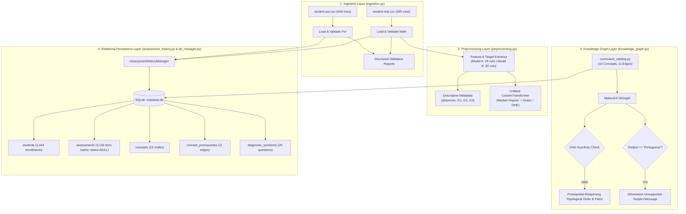
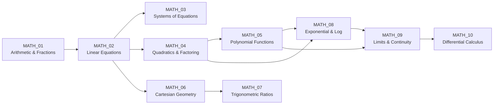

# Module 1 Report: Knowledge Representation and Data Processing
**ExplainAI: An Explainable AI-Based Student Performance Prediction and Personalized Learning Support System for Inclusive and Quality Education**

---

## 1. Module Introduction
Module 1 serves as the foundational data ingestion, structural validation, curriculum representation, and relational persistence layer of the ExplainAI platform. It is engineered to bridge raw secondary academic survey archives with a mathematically formal, graph-based curriculum knowledge representation, establishing the bedrock upon which subsequent predictive modeling (Module 2) and explainable AI interventions (Module 3) operate.

---

## 2. Objectives
1. **Deterministic Data Ingestion**: Reliably parse semicolon-delimited CSV records for Secondary Mathematics (395 records) and Portuguese Language (649 records) without in-place modification.
2. **Strict Schema & Domain Validation**: Enforce categorical domains, numerical boundaries, data types, and non-null integrity across all 33 raw attributes.
3. **Rigorous Anti-Leakage Feature Preprocessing**: Implement separate feature extraction pipelines for Experiment A (29 baseline intake features) and Experiment B (30 features, incorporating early assessment mark $G1$), while strictly barring cumulative absences (`absences`), future midterm marks ($G2$), final examination marks ($G3$), and the derived risk target (`is_at_risk`).
4. **Curriculum-Based Knowledge Graph Modeling**: Codify an educational demonstration curriculum for Secondary Mathematics using NetworkX, formally verifying Directed Acyclic Graph (DAG) acyclicity, topological sequence feasibility, and bidirectional prerequisite traversals.
5. **Demonstration Diagnostic Question Integration**: Provision a verified bank of 20 concept-linked diagnostic questions categorized by Bloom's cognitive taxonomy.
6. **Multi-Subject Relational Persistence with Date Provenance**: Store student profiles, chronological assessment histories, curriculum metadata, and diagnostic questions in SQLite under strict composite key isolation `(student_id, subject)` and foreign key cascade enforcement, while preserving authentic date provenance (`date_provenance = 'NOT_PROVIDED_IN_UCI_SOURCE'`).

---

## 3. System Architecture
Module 1 is decomposed into modular, single-responsibility components within `src/module1_data_knowledge/`:



---

## 4. Dataset Description
ExplainAI utilizes the authentic benchmark UCI Student Performance dataset (Cortez & Silva, 2008), gathered from two Portuguese public secondary institutions: *Escola Secundária Gabriel Pereira* (GP) and *Escola Secundária Mousinho da Silveira* (MS).

### A. Core Dimensions & Partitions
- **Mathematics (`student-mat.csv`)**: 395 student instances, 33 attributes, 0 missing entries.
- **Portuguese Language (`student-por.csv`)**: 649 student instances, 33 attributes, 0 missing entries.
- **Cross-Subject Overlap Analysis**: An empirical join across the 13 demographic matching keys (`school`, `sex`, `age`, `address`, `famsize`, `Pstatus`, `Medu`, `Fedu`, `Mjob`, `Fjob`, `reason`, `nursery`, `internet`) revealed:
  - 358 unambiguous 1-to-1 matching keys.
  - 8 non-unique demographic keys generating 24 Cartesian product rows in `student-merge.R`.
  - 366 total distinct matching-key combinations (explicitly clarifying that these are distinct matching-key combinations, not verified unique individuals).
  - Due to these non-unique keys and differing course-specific marks, subjects are strictly partitioned rather than naively merged.

### B. Attribute Inventory
The 33 attributes encompass student demographics, parental background, academic support, lifestyle indicators, and chronological marks ($G1$, $G2$, $G3$ on a 0–20 scale).

---

## 5. Data Preprocessing Methodology

### A. Prevention of Cross-Fold Information Leakage
To prevent data leakage prior to the train/test split in Module 2:
- Transformers (`StandardScaler`, `OneHotEncoder`, `SimpleImputer`) are **not** fitted during Module 1.
- `DataPreprocessor.build_column_transformer()` constructs and returns an **unfitted** `ColumnTransformer` object.
- Fitting is strictly deferred to the cross-validation training folds in Module 2.

### B. Sub-Pipeline Configuration
- **Numerical Pipeline**:
  - `SimpleImputer(strategy='median')`: Handles missing numerical entries robustly.
  - `StandardScaler()`: Standardizes features to zero mean and unit variance.
- **Categorical Pipeline**:
  - `SimpleImputer(strategy='most_frequent')`: Imputes categorical entries.
  - `OneHotEncoder(handle_unknown='ignore', sparse_output=False)`: Encodes categorical levels into binary dummy features.

---

## 6. Feature Selection and Leakage Prevention

### A. Temporal Limitation and Intake Assumption
The UCI dataset is retrospective and lacks exact day-level collection timestamps. Model A is conceptualized as an **Intake-Screening Model**, operating under the assumption that demographic and historical academic factors are captured at enrollment. This is treated as a transparent design assumption, not an empirical dataset property.

### B. Feature Set Definitions
1. **Model A Feature Set (29 Features)**:
   - 17 Categorical Demographics: `school`, `sex`, `address`, `famsize`, `Pstatus`, `Mjob`, `Fjob`, `reason`, `guardian`, `schoolsup`, `famsup`, `paid`, `activities`, `nursery`, `higher`, `internet`, `romantic`.
   - 12 Numerical Baseline Attributes: `age`, `Medu`, `Fedu`, `traveltime`, `studytime`, `failures`, `famrel`, `freetime`, `goout`, `Dalc`, `Walc`, `health`.
2. **Model B Feature Set (30 Features)**:
   - All 29 Model A features + Early Assessment Grade $G1$.

### C. Strict Anti-Leakage Exclusions
The following attributes are programmatically barred from predictive matrices:
- `absences`: Barred because the UCI archive reports cumulative annual totals (0–93), causing temporal leakage if applied at intake or post-$G1$. Retained only in descriptive metadata.
- `G2`: Midterm evaluation grade (future assessment leakage).
- `G3`: Final examination grade (ground truth target source).
- `is_at_risk`: Binary ground-truth target ($1$ if $G3 < 10$ else $0$).

---

## 7. Knowledge Graph Representation

The Mathematics curriculum knowledge graph is implemented using NetworkX as a Directed Graph $\mathcal{G} = (\mathcal{V}, \mathcal{E})$, where vertices $\mathcal{V}$ represent curriculum concepts and directed edges $(u, v) \in \mathcal{E}$ indicate that concept $u$ is an essential prerequisite for concept $v$.



### Graph Properties:
- Total Concept Nodes ($|\mathcal{V}|$): 10.
- Total Prerequisite Directed Edges ($|\mathcal{E}|$): 11.
- Foundational Root Node: `MATH_01` (in-degree = 0, prerequisites = 0).
- Terminal Leaf Node: `MATH_10` (out-degree = 0, deepest topological depth).
- Verified Acyclic: $0$ cycles detected via `nx.is_directed_acyclic_graph`.

---

## 8. Curriculum Provenance and Limitations

### Provenance Notice:
The 10 concepts and 11 prerequisite relationships represent an academic **Demonstration Curriculum (`DEMONSTRATION_CURRICULUM`)**. While the conceptual progression is modeled upon standard secondary mathematics sequencing, it is **not** an officially certified national syllabus from the Portuguese Direção-Geral da Educação (DGE).

### Subject Boundary:
The concept-level knowledge graph, prerequisite pathways, and diagnostic question banks are strictly restricted to Mathematics. Portuguese language tracking does not possess a concept-level graph; queries for Portuguese return a graceful, transparent system notice without system failure.

---

## 9. Diagnostic Question Integration

A bank of 20 diagnostic questions has been embedded in `src/module1_data_knowledge/curriculum_catalog.py` and synced to SQLite:
- Exactly 2 diagnostic questions per concept.
- Multiple-choice format with 4 options (A, B, C, D) and validated correct keys.
- Detailed step-by-step mathematical explanations.
- Aligned to Bloom's Revised Cognitive Taxonomy: *Remember*, *Understand*, *Apply*, and *Analyze*.
- Explicitly cataloged as application-created demonstration content (`is_uci_source = 0`).

---

## 10. SQLite Database Integration & Date Provenance

The persistence layer uses SQLite with active foreign key constraints (`PRAGMA foreign_keys = ON;`):

### Multi-Subject Student Isolation
Each student enrollment is uniquely identified by the composite primary key `(student_id, subject)`:
- `MAT_001` through `MAT_395` (subject = "Mathematics", source = "UCI_MATHEMATICS").
- `POR_001` through `POR_649` (subject = "Portuguese", source = "UCI_PORTUGUESE").
- Deleting an enrollment in Portuguese cascades only Portuguese assessments, preserving Mathematics records intact.

### Chronological Assessment Trajectories & Date Provenance
The raw UCI dataset provides term period sequencing ($G1 = 1$, $G2 = 2$, $G3 = 3$), but **does not provide calendar assessment dates**. To uphold scientific integrity and avoid presenting generated dates as authentic facts:
- `assessment_date` is explicitly stored as `NULL` (`None`) for all genuine UCI records.
- `date_provenance` is tagged as `'NOT_PROVIDED_IN_UCI_SOURCE'`.
- Chronological sorting is governed by `term_period ASC`, guaranteeing exact academic progression without artificial dates.
- Genuine UCI marks maintain `is_uci_source = 1`.
- Any demonstration or user-added assessment carries an explicit date and is tagged as `'ESTIMATED_DEMONSTRATION'` or `'VERIFIED_USER_ENTERED'` with `is_uci_source = 0`.
Total stored assessments: $395 \times 3 + 649 \times 3 = 3,132$ records.

### Anti-Leakage Post-G1 Isolation
Future prediction workflows operating at the post-$G1$ stage access only the Term 1 feature matrix ($X_B$). $G2$ and $G3$ are structurally absent from the predictive matrix and cannot be reached by the predictor.

---

## 11. Algorithms and Implementation Details

### A. Topological Sorting Learning Order
The valid instructional sequence is computed using Kahn's algorithm via `nx.topological_sort`. This algorithm returns a **valid prerequisite-respecting learning order** guaranteeing that no dependent concept appears before its required foundations:
$$\text{Valid Sequence} = [\text{MATH\_01}, \text{MATH\_02}, \text{MATH\_03}, \text{MATH\_04}, \text{MATH\_06}, \text{MATH\_05}, \text{MATH\_07}, \text{MATH\_08}, \text{MATH\_09}, \text{MATH\_10}]$$
*(Note: Topological sorting guarantees prerequisite compliance; it does not claim to be the single unique or pedagogical optimum.)*

### B. Transitive Prerequisite Ancestry
Ancestral prerequisites are retrieved via graph depth-first traversal (`nx.ancestors`), intersected and ordered according to the topological sequence to yield immediate remedial study paths.

---

## 12. Test Cases and Actual Results

The automated test suite comprises **20 dedicated unit and integration tests** across [`tests/test_step2_scaffolding.py`](file:///c:/Users/BAGYALAKSHMI/OneDrive/Desktop/KE/tests/test_step2_scaffolding.py) and [`tests/test_module1_data_kg.py`](file:///c:/Users/BAGYALAKSHMI/OneDrive/Desktop/KE/tests/test_module1_data_kg.py):

Command:
```powershell
python -m pytest tests/ -v
```

Execution Output:
```
============================= test session starts =============================
platform win32 -- Python 3.13.12, pytest-9.1.1, pluggy-1.6.0
rootdir: C:\Users\BAGYALAKSHMI\OneDrive\Desktop\KE
plugins: anyio-4.14.1
collected 20 items

tests/test_module1_data_kg.py::test_dataset_loading_row_and_column_counts PASSED [  5%]
tests/test_module1_data_kg.py::test_dataset_columns_and_data_types PASSED [ 10%]
tests/test_module1_data_kg.py::test_missing_values_and_duplicate_detection PASSED [ 15%]
tests/test_module1_data_kg.py::test_model_a_feature_count_and_leakage_exclusion PASSED [ 20%]
tests/test_module1_data_kg.py::test_model_b_feature_count_and_early_assessment PASSED [ 25%]
tests/test_module1_data_kg.py::test_unfitted_column_transformer PASSED   [ 30%]
tests/test_module1_data_kg.py::test_knowledge_graph_structure PASSED     [ 35%]
tests/test_module1_data_kg.py::test_prerequisite_retrieval_and_transitive_closure PASSED [ 40%]
tests/test_module1_data_kg.py::test_topological_order_and_paths PASSED   [ 45%]
tests/test_module1_data_kg.py::test_unsupported_subject_knowledge_graph PASSED [ 50%]
tests/test_module1_data_kg.py::test_diagnostic_questions_integrity PASSED [ 55%]
tests/test_module1_data_kg.py::test_sqlite_student_and_assessment_sync PASSED [ 60%]
tests/test_module1_data_kg.py::test_post_g1_prediction_cannot_access_future_assessments PASSED [ 65%]
tests/test_module1_data_kg.py::test_sqlite_foreign_key_and_rollback PASSED [ 70%]
tests/test_step2_scaffolding.py::test_dependencies_imported PASSED       [ 75%]
tests/test_step2_scaffolding.py::test_uci_datasets_exist_and_valid PASSED [ 80%]
tests/test_step2_scaffolding.py::test_curriculum_provenance_dag_and_subject_restriction PASSED [ 85%]
tests/test_step2_scaffolding.py::test_feature_counts_and_leakage_prevention PASSED [ 90%]
tests/test_step2_scaffolding.py::test_cross_subject_student_matching_analysis PASSED [ 95%]
tests/test_step2_scaffolding.py::test_database_multi_subject_isolation_and_foreign_keys PASSED [100%]

======================= 20 passed, 14 warnings in 8.78s =======================
```

### Explanation of Test Warnings:
The 14 deprecation warnings emitted during test execution are internal to Matplotlib's font configuration parser on Python 3.13 (`PyparsingDeprecationWarning: 'resetCache' deprecated - use 'reset_cache'`). They do not originate from application logic and have no effect on data processing, graph operations, or database persistence.

*(Note on code coverage: The automated test suite achieves passing results on all 20 specified behavioral and integration test cases. A line-level percentage claim is deliberately omitted as a formal coverage profiling tool was not executed).*

---

## 13. Limitations
1. **Absence Variable Granularity**: Cumulative annual absence totals are barred from model features to avoid temporal leakage, limiting predictive models to pre-course survey and early exam features.
2. **Demonstration Curriculum Scope**: Concept-level knowledge graph modeling is restricted to Mathematics; Portuguese language records do not have a concept-level graph.
3. **Cross-Course Entity Resolution**: Because 8 demographic key groups share identical attributes across subjects, unambiguous 1-to-1 linkage across courses cannot be guaranteed for all students.
4. **Absence of Historical Calendar Dates**: The authentic UCI dataset provides chronological terms ($G1, G2, G3$) without calendar dates. Assessment dates are stored as `NULL` with explicit provenance indicators.

---

## 14. Module Conclusion
Module 1 has been successfully constructed, validated, and verified. It delivers clean, unpolluted data pipelines, anti-leakage feature sets, a verified Mathematics DAG knowledge graph, a 20-question diagnostic bank, and a multi-subject relational database populated with 1,044 student profiles and 3,132 assessment records. The module is fully prepared for Module 2 predictive modeling and warning systems.
