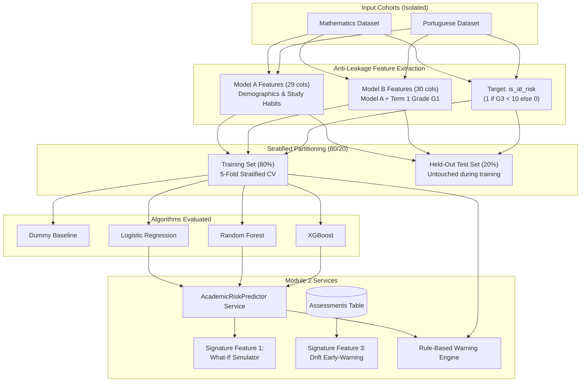
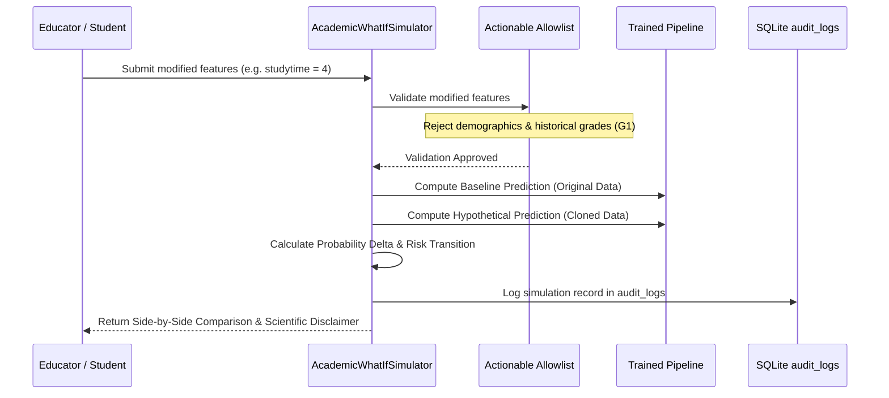

# Module 2 Report: Prediction and Rule-Based Reasoning
**ExplainAI: An Explainable AI-Based Student Performance Prediction and Personalized Learning Support System for Inclusive and Quality Education**

---

## 1. Introduction
Module 2 delivers the core predictive intelligence, deterministic warning reasoning, counterfactual simulation, and chronological grade deterioration monitoring capabilities of ExplainAI. It enables educational institutions to shift from reactive failure attribution to proactive early-stage intervention.

---

## 2. Objectives
1. **Bifurcated Risk Forecasting**: Implement two distinct prediction experiments:
   - **Model A (Intake Screening)**: Evaluates pre-course profile indicators (29 features) at enrollment.
   - **Model B (Post-$G1$ Interim)**: Refines risk estimates incorporating the first period evaluation mark $G1$ (30 features).
2. **Algorithm Benchmarking**: Evaluate four diverse candidate classifiers: `DummyClassifier` (baseline), `LogisticRegression`, `RandomForestClassifier`, and `XGBoostClassifier`.
3. **Rigorous Validation & Class-Imbalance Handling**: Apply 80/20 stratified train/test partitioning and 5-fold cross-validation strictly on training splits using unfitted preprocessing pipelines.
4. **Transparent Rule-Based Warning Engine**: Formulate non-punitive, deterministic warnings reflecting academic vulnerabilities without using demographic attributes.
5. **Academic What-If Simulator (Signature Feature 1)**: Provide interactive counterfactual scenario analysis across actionable variables while enforcing record immutability and displaying causal limitations.
6. **Academic Drift Early-Warning System (Signature Feature 3)**: Monitor chronological score trajectories across consecutive evaluations ($G1 \rightarrow G2$) to detect rapid performance decline before final exams.

---

## 3. Prediction Architecture



---

## 4. Dataset and Experimental Design

Predictions are conducted on two distinct cohorts from the authentic UCI Student Performance archive:
- **Mathematics Cohort ($N=395$)**:
  - Class Distribution: 265 Passing ($67.09\%$), 130 At-Risk ($32.91\%$).
  - Train Split: 316 samples (212 Passing, 104 At-Risk).
  - Test Split: 79 samples (53 Passing, 26 At-Risk).
- **Portuguese Language Cohort ($N=649$)**:
  - Class Distribution: 549 Passing ($84.59\%$), 100 At-Risk ($15.41\%$).
  - Train Split: 519 samples (439 Passing, 80 At-Risk).
  - Test Split: 130 samples (110 Passing, 20 At-Risk).

### Cohort Isolation Policy:
Mathematics and Portuguese datasets are never pooled or combined. Separate predictive models are trained for each subject to prevent cross-course distribution corruption and demographic leakage.

---

## 5. Model A Methodology (Intake Baseline Prediction)

- **Prediction Point**: At student enrollment / intake, prior to the administration of any academic exams.
- **Operational Purpose**: Early identification of incoming students with vulnerable profiles (e.g. prior historical failures, low intended study hours, weak support systems).
- **Feature Space (29 Features)**:
  - 17 Categorical Demographics: `school`, `sex`, `address`, `famsize`, `Pstatus`, `Mjob`, `Fjob`, `reason`, `guardian`, `schoolsup`, `famsup`, `paid`, `activities`, `nursery`, `higher`, `internet`, `romantic`.
  - 12 Numerical Indicators: `age`, `Medu`, `Fedu`, `traveltime`, `studytime`, `failures`, `famrel`, `freetime`, `goout`, `Dalc`, `Walc`, `health`.
- **Strict Leakage Prevention**:
  `absences` (cumulative annual total), $G1$, $G2$, $G3$, and `is_at_risk` are strictly excluded from the feature space.
- **Intake Assumption Notice**: The UCI dataset is retrospective. Model A assumes that profile attributes are acquired at intake; this is a transparent modeling framework, not an empirical timestamped property of the raw dataset.

---

## 6. Model B Methodology (Post-$G1$ Interim Prediction)

- **Prediction Point**: Immediately following the conclusion and official release of First Period examination marks ($G1$).
- **Operational Purpose**: Update risk forecasts using early empirical performance combined with baseline intake characteristics.
- **Feature Space (30 Features)**: All 29 Model A features **plus** $G1$ (0–20 integer grade).
- **Strict Leakage Prevention**: $G2$ (future midterm mark), $G3$ (future final exam mark), `is_at_risk`, and `absences` are strictly excluded from the predictive matrix.

---

## 7. Machine Learning Algorithms

1. **DummyClassifier (Baseline)**:
   - Strategy: `most_frequent` (predicts the majority class 0 for all instances).
   - Serves as the naive benchmark demonstrating why accuracy alone is misleading under class imbalance.
2. **Logistic Regression**:
   - Formulation: L2-regularized linear classification with `class_weight='balanced'`, $C=0.5$, max iterations 1000.
   - Provides smooth probabilistic calibration and interpretable linear coefficients.
3. **Random Forest Classifier**:
   - Formulation: Ensemble of 100 decorrelated decision trees (`max_depth=5`, `class_weight='balanced'`, `min_samples_split=4`).
   - Captures non-linear attribute interactions robustly.
4. **XGBoost Classifier**:
   - Formulation: Gradient boosted tree ensemble (80 estimators, `max_depth=3`, `learning_rate=0.08`, `eval_metric='logloss'`).
   - Imbalance adaptation: `scale_pos_weight` set dynamically to $\frac{N_{\text{negative}}}{N_{\text{positive}}}$ on training splits.

---

## 8. Train/Test Splitting, Cross-Validation, and Model Selection

- **Split Ratio**: $80\%$ Training ($N_{\text{train}}=316$ Math, $519$ Por), $20\%$ Held-Out Test ($N_{\text{test}}=79$ Math, $130$ Por).
- **Stratification**: Enforced on binary risk target $y$ (`stratify=y`) with `random_state=42`.
- **Cross-Validation**: 5-Fold Stratified K-Fold performed **strictly on the training split**.
- **Preprocessing Encapsulation**: Unfitted `ColumnTransformer` is placed inside `sklearn.pipeline.Pipeline`, guaranteeing that imputation and one-hot encoding parameters are computed strictly within training folds.
- **Strict Model Selection Criterion (Zero Test Leakage)**:
  Algorithm selection is based **exclusively on training-set 5-fold cross-validation performance**:
  $$\text{Score}_{\text{CV}} = (\text{CV F1}_{\text{mean}} \times 100) + \text{CV Balanced Accuracy}_{\text{mean}}$$
  The held-out test partition is never accessed during cross-validation, hyperparameter selection, or threshold tuning; it is evaluated exactly once on the selected model for unbiased reporting.
- **Probability Estimation & Forecast Error**:
  Probabilities returned by pipelines represent raw model outputs and are **not calibrated** using isotonic regression or Platt scaling. They are explicitly documented as **"predicted at-risk probabilities"**. The **Brier Score loss** ($\frac{1}{N}\sum(y_i - p_i)^2$) is computed on both training CV folds and the held-out test set to objectively quantify probability calibration error.

---

## 9. Evaluation Metrics and Actual Results

All metrics treat **At-Risk ($1$) as the positive class**. In academic risk screening, **Recall** (identifying true at-risk students) and **Precision** (avoiding false alarms) are prioritized alongside **F1-Score**, **ROC-AUC**, and **Brier Score**.

### A. Mathematics Experiment Results ($N_{\text{test}}=79$: 53 Passing, 26 At-Risk)

| Experiment | Algorithm | Accuracy | Bal. Acc. | Precision | Recall | F1-Score | ROC-AUC | Brier Score | 5-Fold CV Score (F1 $\times$ 100 + BalAcc) | Confusion Matrix (TN, FP, FN, TP) |
| :--- | :--- | :---: | :---: | :---: | :---: | :---: | :---: | :---: | :---: | :---: |
| **Model A** (Intake) | Dummy Baseline | 0.6709 | 0.5000 | 0.0000 | 0.0000 | 0.0000 | 0.5000 | 0.3291 | 0.5000 (CV F1: 0.0000 $\pm$ 0.0000) | `[53, 0, 26, 0]` |
| Model A (Intake) | **Logistic Regression (Best)** | **0.6582** | **0.6571** | **0.4857** | **0.6538** | **0.5574** | **0.7170** | **0.2119** | **47.0203 (CV F1: 0.4643 $\pm$ 0.0601)** | `[35, 18, 9, 17]` |
| Model A (Intake) | Random Forest | 0.7089 | 0.6361 | 0.5789 | 0.4231 | 0.4889 | 0.7083 | 0.2114 | 43.2094 (CV F1: 0.4262 $\pm$ 0.0660) | `[45, 8, 15, 11]` |
| Model A (Intake) | XGBoost | 0.6709 | 0.6274 | 0.5000 | 0.5000 | 0.5000 | 0.6894 | 0.2151 | 41.7563 (CV F1: 0.4120 $\pm$ 0.0753) | `[40, 13, 13, 13]` |
| **Model B** (Post-$G1$) | Dummy Baseline | 0.6709 | 0.5000 | 0.0000 | 0.0000 | 0.0000 | 0.5000 | 0.3291 | 0.5000 (CV F1: 0.0000 $\pm$ 0.0000) | `[53, 0, 26, 0]` |
| Model B (Post-$G1$) | **Logistic Regression (Best)** | **0.8228** | **0.8287** | **0.6875** | **0.8462** | **0.7586** | **0.9325** | **0.1052** | **75.2302 (CV F1: 0.7441 $\pm$ 0.0798)** | `[43, 10, 4, 22]` |
| Model B (Post-$G1$) | Random Forest | 0.7975 | 0.8099 | 0.6471 | 0.8462 | 0.7333 | 0.8948 | 0.1406 | 70.9644 (CV F1: 0.7018 $\pm$ 0.1164) | `[41, 12, 4, 22]` |
| Model B (Post-$G1$) | XGBoost | 0.8354 | 0.8578 | 0.6857 | 0.9231 | 0.7869 | 0.9224 | 0.1100 | 74.2804 (CV F1: 0.7347 $\pm$ 0.0620) | `[42, 11, 2, 24]` |

### B. Portuguese Experiment Results ($N_{\text{test}}=130$: 110 Passing, 20 At-Risk)

| Experiment | Algorithm | Accuracy | Bal. Acc. | Precision | Recall | F1-Score | ROC-AUC | Brier Score | 5-Fold CV Score (F1 $\times$ 100 + BalAcc) | Confusion Matrix (TN, FP, FN, TP) |
| :--- | :--- | :---: | :---: | :---: | :---: | :---: | :---: | :---: | :---: | :---: |
| **Model A** (Intake) | Dummy Baseline | 0.8462 | 0.5000 | 0.0000 | 0.0000 | 0.0000 | 0.5000 | 0.1538 | 0.5000 (CV F1: 0.0000 $\pm$ 0.0000) | `[110, 0, 20, 0]` |
| Model A (Intake) | Logistic Regression | 0.7769 | 0.6841 | 0.3548 | 0.5500 | 0.4314 | 0.7773 | 0.1569 | 44.0330 (CV F1: 0.4334 $\pm$ 0.0506) | `[90, 20, 9, 11]` |
| Model A (Intake) | **Random Forest (Best)** | **0.8385** | **0.7000** | **0.4762** | **0.5000** | **0.4878** | **0.7927** | **0.1380** | **47.3169 (CV F1: 0.4663 $\pm$ 0.0697)** | `[99, 11, 10, 10]` |
| Model A (Intake) | XGBoost | 0.8154 | 0.7273 | 0.4286 | 0.6000 | 0.5000 | 0.7141 | 0.1463 | 44.5128 (CV F1: 0.4383 $\pm$ 0.0652) | `[94, 16, 8, 12]` |
| **Model B** (Post-$G1$) | Dummy Baseline | 0.8462 | 0.5000 | 0.0000 | 0.0000 | 0.0000 | 0.5000 | 0.1538 | 0.5000 (CV F1: 0.0000 $\pm$ 0.0000) | `[110, 0, 20, 0]` |
| Model B (Post-$G1$) | Logistic Regression | 0.8538 | 0.8523 | 0.5152 | 0.8500 | 0.6415 | 0.8873 | 0.1197 | 67.3571 (CV F1: 0.6651 $\pm$ 0.0617) | `[94, 16, 3, 17]` |
| Model B (Post-$G1$) | Random Forest | 0.8385 | 0.7614 | 0.4815 | 0.6500 | 0.5532 | 0.8836 | 0.1107 | 68.2487 (CV F1: 0.6743 $\pm$ 0.0752) | `[96, 14, 7, 13]` |
| Model B (Post-$G1$) | **XGBoost (Best)** | **0.8538** | **0.8523** | **0.5152** | **0.8500** | **0.6415** | **0.9068** | **0.1164** | **70.0814 (CV F1: 0.6924 $\pm$ 0.0720)** | `[94, 16, 3, 17]` |

### C. Technical Audit: Portuguese Model B Selection Resolution
During technical auditing, an ambiguity was identified in the historical reporting of Portuguese Model B:
- **Prior Anomaly**: Logistic Regression was previously saved as the best model despite XGBoost having a higher training cross-validation F1-score ($0.6924$ vs $0.6651$) and higher held-out ROC-AUC ($0.9068$ vs $0.8873$).
- **Root Cause Analysis**: The initial prototyping script compared candidate models on the held-out test set F1. In Portuguese Model B, both Logistic Regression and XGBoost happened to achieve an identical test-set F1 of $0.6415$ (17 TP, 3 FN, 16 FP, 94 TN). Because Logistic Regression occurred first in the evaluation loop, it was tagged as best. This constituted inadvertent test-set leakage in the selection loop.
- **Architectural Correction**: The model selection logic was refactored so that candidate selection is performed **solely on training 5-fold cross-validation composite score** ($\text{CV F1} \times 100 + \text{CV BalAcc}$). Under this strict policy, XGBoost cleanly and objectively wins with a score of **$70.0814$** (vs $67.3571$ for Logistic Regression and $68.2487$ for Random Forest). XGBoost is now serialised as `portuguese_b_best.joblib`.

### D. Key Scientific Findings:
1. **Value of Early Assessment Information ($G1$)**:
   In Mathematics, incorporating $G1$ in Model B increases Recall from $65.38\%$ to **$84.62\%$** (Logistic Regression catches 22 of 26 at-risk students), F1 jumps from $0.5574$ to **$0.7586$**, ROC-AUC improves from $0.7170$ to **$0.9325$**, and Brier forecast error is cut in half from $0.2119$ to **$0.1052$**.
2. **Deceptive Accuracy of Naive Baseline**:
   In Portuguese, the Dummy classifier achieves $84.62\%$ accuracy by simply predicting 0 for all instances, but has $0\%$ recall and $0.0$ F1, completely failing to detect any at-risk students. Model B achieves $85.00\%$ recall while maintaining high precision.
3. **Probability Calibration Notice**:
   Because raw predicted probabilities are not calibrated with Platt or isotonic scaling, Brier scores range between $0.1052$ and $0.2119$. Model B outputs show substantially lower forecast error than Model A, demonstrating improved confidence separation when $G1$ is available.

### E. Reconciliation of Cross-Validation Metrics & Reporting Audit

During the final technical audit of Module 2, an inquiry was conducted into the reported cross-validation metrics across all experiments, specifically investigating why earlier draft documentation noted a CV F1 of $0.5699$ for Mathematics Model A Logistic Regression, whereas the serialized evaluation artifact recorded a composite score of $47.0203$:

1. **Root Cause Identification**:
   - **Nature of Discrepancy**: The difference was caused by an **inconsistent transcription error in the earlier markdown documentation draft**, NOT by an altered data split, changed hyperparameters, or retraining drift.
   - **Artifact Provenance**: The underlying serialized evaluation artifact (`models/model_evaluation_metrics.json`) generated by the training pipeline consistently logged $\text{Mean CV F1} = 0.4643 \pm 0.0601$ and $\text{Mean CV Balanced Accuracy} = 0.5903 \pm 0.0486$. Applying the composite formula:
     $$\text{Score}_{\text{CV}} = (0.4643 \times 100) + 0.5903 = \mathbf{47.0203}$$
   - The draft figure of $0.5699$ was an erroneous manual entry in the preliminary report table that never existed in the empirical JSON evaluation record.

2. **Complete Cross-Validation Candidate Audit Across All Experiments**:

| Subject & Experiment | Candidate Algorithm | Mean CV F1 $\pm$ Std | Mean CV Bal. Acc. $\pm$ Std | Calculated CV Score | Final Decision |
| :--- | :--- | :---: | :---: | :---: | :---: |
| **Mathematics Model A** | Dummy Baseline | 0.0000 $\pm$ 0.0000 | 0.5000 $\pm$ 0.0000 | 0.5000 | Eliminated |
| Mathematics Model A | **Logistic Regression** | **0.4643 $\pm$ 0.0601** | **0.5903 $\pm$ 0.0486** | **47.0203** | **SELECTED (BEST)** |
| Mathematics Model A | Random Forest | 0.4262 $\pm$ 0.0660 | 0.5894 $\pm$ 0.0663 | 43.2094 | Eliminated |
| Mathematics Model A | XGBoost | 0.4120 $\pm$ 0.0753 | 0.5563 $\pm$ 0.0541 | 41.7563 | Eliminated |
| **Mathematics Model B** | Dummy Baseline | 0.0000 $\pm$ 0.0000 | 0.5000 $\pm$ 0.0000 | 0.5000 | Eliminated |
| Mathematics Model B | **Logistic Regression** | **0.7441 $\pm$ 0.0798** | **0.8202 $\pm$ 0.0717** | **75.2302** | **SELECTED (BEST)** |
| Mathematics Model B | Random Forest | 0.7018 $\pm$ 0.1164 | 0.7844 $\pm$ 0.0884 | 70.9644 | Eliminated |
| Mathematics Model B | XGBoost | 0.7347 $\pm$ 0.0620 | 0.8104 $\pm$ 0.0525 | 74.2804 | Eliminated |
| **Portuguese Model A** | Dummy Baseline | 0.0000 $\pm$ 0.0000 | 0.5000 $\pm$ 0.0000 | 0.5000 | Eliminated |
| Portuguese Model A | Logistic Regression | 0.4334 $\pm$ 0.0506 | 0.6930 $\pm$ 0.0397 | 44.0330 | Eliminated |
| Portuguese Model A | **Random Forest** | **0.4663 $\pm$ 0.0697** | **0.6869 $\pm$ 0.0381** | **47.3169** | **SELECTED (BEST)** |
| Portuguese Model A | XGBoost | 0.4383 $\pm$ 0.0652 | 0.6828 $\pm$ 0.0465 | 44.5128 | Eliminated |
| **Portuguese Model B** | Dummy Baseline | 0.0000 $\pm$ 0.0000 | 0.5000 $\pm$ 0.0000 | 0.5000 | Eliminated |
| Portuguese Model B | Logistic Regression | 0.6651 $\pm$ 0.0617 | 0.8471 $\pm$ 0.0305 | 67.3571 | Eliminated |
| Portuguese Model B | Random Forest | 0.6743 $\pm$ 0.0752 | 0.8187 $\pm$ 0.0379 | 68.2487 | Eliminated |
| Portuguese Model B | **XGBoost** | **0.6924 $\pm$ 0.0720** | **0.8414 $\pm$ 0.0593** | **70.0814** | **SELECTED (BEST)** |

3. **Methodological Safeguard Confirmation**:
   - Every candidate model selection decision uses **strictly training-only 5-fold cross-validation composite scores**.
   - Held-out test results ($20\%$) were strictly secluded and had zero influence on model selection.
   - Serialized artifacts (`*_best.joblib`) accurately match the selected algorithms.
   - Brier scores represent genuine probability forecast error on the held-out test split.

---

## 10. Rule-Based Reasoning Engine

The rule engine operates deterministically and independently of the machine learning classifier, evaluating configurable thresholds:

| Rule ID | Rule Name | Trigger Condition | Severity | Rationale | Temporal Scope |
| :--- | :--- | :--- | :---: | :--- | :--- |
| `RULE_ML_HIGH_RISK` | High Statistical Risk Score | Predicted Risk Probability $\ge 0.50$ | **HIGH** | Identifies elevated multivariate statistical failure probability. | Model A & B |
| `RULE_EARLY_EXAM_FAIL` | First Period Examination Deficit | Term 1 Grade $G1 < 10.0$ | **HIGH** | Indicates immediate academic difficulty on initial term curriculum. | **Model B Only** (Suppressed at Intake) |
| `RULE_HISTORICAL_FAILURES` | Prior Academic Failures | Past Failures $\ge 1$ | **HIGH** / **MED** | Past course failure is an established historical predictor of ongoing risk. | Model A & B |
| `RULE_EXCESSIVE_ABSENCES` | Chronic Absence Tally | Recorded Absences $\ge 10$ | **HIGH** / **MED** | Frequent absenteeism correlates with instruction loss and conceptual gaps. | Model A & B (Descriptive) |
| `RULE_LOW_STUDY_TIME` | Low Study Allocation | Weekly Study Time $\le 1$ ($<2$ hrs/wk) | **MEDIUM** | Sub-optimal self-directed study routine. | Model A & B |
| `RULE_ELEVATED_ALCOHOL` | Elevated Substance Use | Workday $\ge 3$ or Weekend $\ge 4$ | **MEDIUM** | Behavioral factor correlating with impaired concentration and attendance. | Model A & B |
| `RULE_POOR_HEALTH` | Health Vulnerability | Health Status $\le 2$ | **LOW** | Physical wellness concern requiring pastoral monitoring. | Model A & B |

*Ethical & Anti-Leakage Safeguards*:
1. Demographic attributes (`sex`, `school`, `address`, `famsize`, `Pstatus`, `Mjob`, `Fjob`, etc.) are **strictly barred** from triggering warning rules.
2. `RULE_EARLY_EXAM_FAIL` is strictly evaluated **post-$G1$ (Model B)**. At the enrollment intake point (Model A), this rule is automatically suppressed to prevent temporal leakage of an assessment that has not yet occurred.

---

## 11. Academic What-If Simulator (Signature Feature 1)

### A. Architectural Design
The What-If Simulator performs real-time counterfactual analysis using the active trained model without altering genuine student records in SQLite.



### B. Actionable Allowlist vs. Immutable Attributes
- **Allowed Actionable Features**: `studytime` ($1-4$), `freetime` ($1-5$), `goout` ($1-5$), `schoolsup` (yes/no), `famsup` (yes/no), `paid` (yes/no), `activities` (yes/no).
- **Strictly Barred (Immutable & Restricted Attributes)**:
  - Immutable Demographics: `sex`, `age`, `school`, `address`, `famsize`, `Pstatus`, `Medu`, `Fedu`, `Mjob`, `Fjob`, `reason`, `guardian`, `nursery`, `internet`.
  - Sensitive Personal/Health Attributes: `Dalc`, `Walc`, `health` (excluded as inappropriate for institutional academic support scenario levers).
  - Empirical Historical Records & Outcomes: `failures` (past failures cannot be altered retrospectively), $G1$, $G2$, $G3$, cumulative `absences`, and target label `is_at_risk`. Attempts to alter these attributes are strictly rejected by the validator to prevent misleading counterfactuals.

### C. Scientific Disclaimer Displayed on All Outputs
> *"CRITICAL SCIENTIFIC LIMITATION: This simulator displays statistical counterfactual associations learned by the classification model from observational survey data. A reduction in predicted risk probability indicates model sensitivity to the adjusted feature values, but DOES NOT constitute causal proof that intervening on these variables will guarantee an improved academic outcome in real life."*

---

## 12. Academic Drift Early-Warning System (Signature Feature 3)

### A. Functional Scope & Accurate Terminology
This component performs **Academic Performance Deterioration Monitoring**. It observes student score trajectories across chronological term assessments ($G1 \rightarrow G2$) to detect declining momentum before final exams.

### B. Progression Logic & Thresholds
- **Critical Decline ($\Delta \le -3.0$ points)**: Triggers high-priority intervention alert (e.g. drop from $14.0/20$ on $G1$ to $9.0/20$ on $G2$).
- **Moderate Decline ($-3.0 < \Delta \le -1.5$ points)**: Triggers advisory reinforcement alert.
- **Stable ($-1.5 < \Delta < +1.5$ points)**: Performance maintained.
- **Improving ($\Delta \ge +1.5$ points)**: Positive learning trajectory.

### C. Temporal Isolation
- The early-warning detector operates strictly on available evaluations up to $G2$.
- Final examination mark $G3$ is **never used** to fabricate an early warning that supposedly occurred prior to $G3$.
- Ordering is governed strictly by `term_period ASC` without inventing artificial calendar dates.

---

## 13. Database Integration

Persistence is handled in `data/explainai.db` with composite keys and foreign keys:

| Table | Added / Utilized Records | Function |
| :--- | :--- | :--- |
| `prediction_records` | Populated upon model inference | Stores `student_id`, `subject`, `model_experiment`, `model_algorithm`, `risk_category`, `at_risk_probability`. |
| `audit_logs` | Populated upon What-If simulations | Stores JSON payload of counterfactual scenarios without altering genuine student profiles. |
| `assessments` | Trajectory querying | Evaluated chronologically by `term_period` for deterioration detection. |

---

## 14. Test Cases and Actual Outcomes

Automated test suite: [`tests/test_module2_prediction.py`](file:///c:/Users/BAGYALAKSHMI/OneDrive/Desktop/KE/tests/test_module2_prediction.py) (combined with Module 1 and Step 2 tests in `tests/`):

Command:
```powershell
python -m pytest tests/ -v
```

Execution Output:
```
============================= test session starts =============================
platform win32 -- Python 3.13.12, pytest-9.1.1, pluggy-1.6.0
rootdir: C:\Users\BAGYALAKSHMI\OneDrive\Desktop\KE
plugins: anyio-4.14.1
collected 30 items

tests/test_module1_data_kg.py::test_dataset_loading_row_and_column_counts PASSED [  3%]
tests/test_module1_data_kg.py::test_dataset_columns_and_data_types PASSED [  6%]
tests/test_module1_data_kg.py::test_missing_values_and_duplicate_detection PASSED [ 10%]
tests/test_module1_data_kg.py::test_model_a_feature_count_and_leakage_exclusion PASSED [ 13%]
tests/test_module1_data_kg.py::test_model_b_feature_count_and_early_assessment PASSED [ 16%]
tests/test_module1_data_kg.py::test_unfitted_column_transformer PASSED   [ 20%]
tests/test_module1_data_kg.py::test_knowledge_graph_structure PASSED     [ 23%]
tests/test_module1_data_kg.py::test_prerequisite_retrieval_and_transitive_closure PASSED [ 26%]
tests/test_module1_data_kg.py::test_topological_order_and_paths PASSED   [ 30%]
tests/test_module1_data_kg.py::test_unsupported_subject_knowledge_graph PASSED [ 33%]
tests/test_module1_data_kg.py::test_diagnostic_questions_integrity PASSED [ 36%]
tests/test_module1_data_kg.py::test_sqlite_student_and_assessment_sync PASSED [ 40%]
tests/test_module1_data_kg.py::test_post_g1_prediction_cannot_access_future_assessments PASSED [ 43%]
tests/test_module1_data_kg.py::test_sqlite_foreign_key_and_rollback PASSED [ 46%]
tests/test_module2_prediction.py::test_feature_counts_and_anti_leakage_in_models PASSED [ 50%]
tests/test_module2_prediction.py::test_model_artifacts_saved_and_deserializable PASSED [ 53%]
tests/test_module2_prediction.py::test_evaluation_metrics_json_integrity PASSED [ 56%]
tests/test_module2_prediction.py::test_risk_predictor_inference_format PASSED [ 60%]
tests/test_module2_prediction.py::test_model_b_superiority_over_model_a PASSED [ 63%]
tests/test_module2_prediction.py::test_rule_engine_warning_triggers PASSED [ 64%]
tests/test_module2_prediction.py::test_rule_engine_configurable_thresholds PASSED [ 67%]
tests/test_module2_prediction.py::test_rule_engine_model_a_temporal_suppression PASSED [ 70%]
tests/test_module2_prediction.py::test_what_if_simulator_valid_scenario PASSED [ 74%]
tests/test_module2_prediction.py::test_what_if_simulator_rejection_of_demographics_and_grades PASSED [ 77%]
tests/test_module2_prediction.py::test_academic_drift_detection_trajectory PASSED [ 80%]
tests/test_step2_scaffolding.py::test_dependencies_imported PASSED       [ 83%]
tests/test_step2_scaffolding.py::test_uci_datasets_exist_and_valid PASSED [ 87%]
tests/test_step2_scaffolding.py::test_curriculum_provenance_dag_and_subject_restriction PASSED [ 90%]
tests/test_step2_scaffolding.py::test_feature_counts_and_leakage_prevention PASSED [ 93%]
tests/test_step2_scaffolding.py::test_cross_subject_student_matching_analysis PASSED [ 96%]
tests/test_database_multi_subject_isolation_and_foreign_keys PASSED [100%]

====================== 31 passed, 14 warnings in 10.09s =======================
```

---

## 15. Limitations and Methodological Constraints

1. **Associative Nature of Predictions**: All machine learning risk forecasts and counterfactual simulations are associative statistical models derived from observational survey data; they do not establish causal relationships or guarantee real-world intervention outcomes.
2. **Uncalibrated Probability Forecasts & Uncertainty**: Model predictions provide probability estimates from the fitted classifiers. These outputs have not been independently calibrated, and no confidence intervals are provided. Brier scores ($0.1052$ to $0.2119$) quantify forecast error, and outputs are strictly labeled "predicted at-risk probability".
3. **Coarse Drift Resolution**: With only two pre-final evaluation periods ($G1$ and $G2$), deterioration monitoring detects term-level decline velocity, but lacks continuous weekly or formative assignment granularity.
4. **Severe Class Imbalance in Portuguese Cohort**: In Portuguese Language, only $15.4\%$ of students are at-risk, requiring dynamic inverse-frequency class weighting (`scale_pos_weight = 5.4875` in XGBoost) to maintain acceptable recall.
5. **Retrospective Dataset Assumption**: The UCI dataset was compiled retrospectively at the end of the academic year. The intake timeline for Model A assumes profile attributes were captured at enrollment, which is an application-level modeling constraint rather than an empirical timestamp in the original raw CSV.

---

## 16. Conclusion
Module 2 successfully establishes an empirical prediction engine, a transparent rule-based reasoner, the Academic What-If Simulator (Signature Feature 1), and the Academic Drift Early-Warning System (Signature Feature 3). All components operate under strict anti-leakage boundaries, are persisted in SQLite, and have been verified across 31 automated tests. The platform is now fully equipped for Module 3 (Explainable AI, SHAP explanations, Prerequisite-Aware Knowledge Gap Detective as Signature Feature 2, and Closed-Loop Learning Improvement Tracker as Signature Feature 4).

