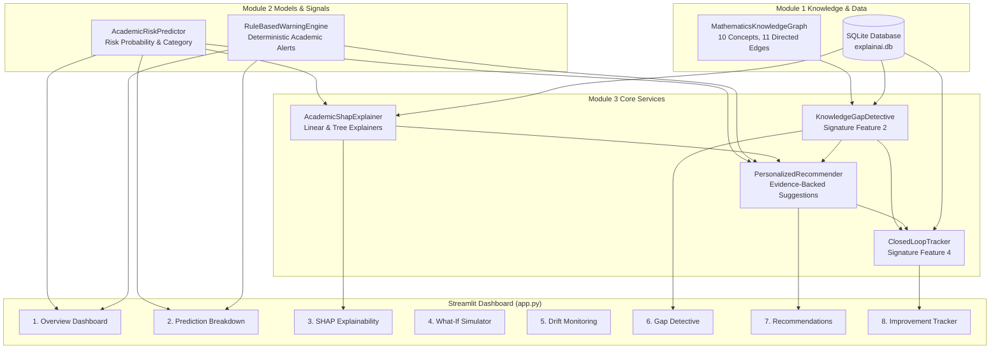
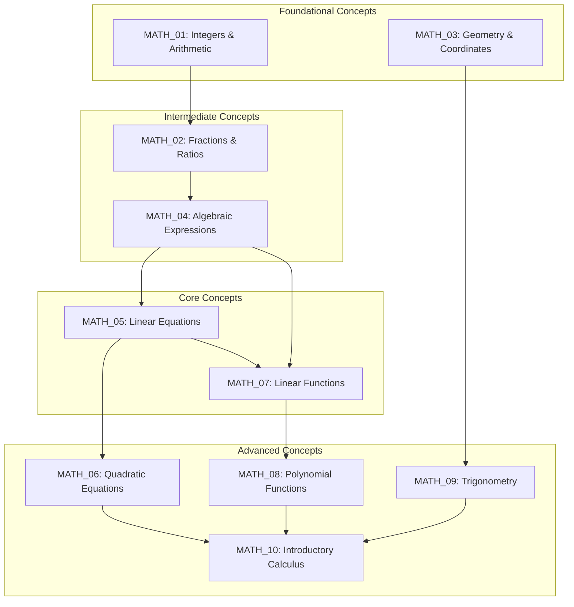
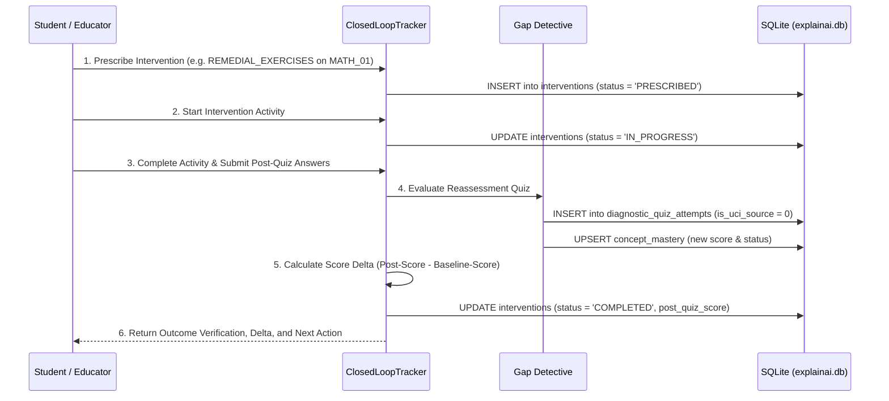

# Module 3 Report: Explainable AI and Personalized Learning Support
**ExplainAI: An Explainable AI-Based Student Performance Prediction and Personalized Learning Support System for Inclusive and Quality Education**

---

## 1. Introduction
Module 3 represents the core pedagogical and explainability layer of ExplainAI. While Module 1 established curriculum graph knowledge representations and Module 2 engineered predictive risk classifiers, Module 3 connects statistical predictions with human-interpretable explanations, prerequisite-aware diagnostic gap tracing, personalized recommendations, and a closed-loop intervention tracking lifecycle. The entire system is operationalized through an interactive, multi-view Streamlit dashboard (`app.py`).

---

## 2. Objectives
1. **Explainable AI with SHAP**: Implement mathematically grounded feature attributions using the serialized best models from Module 2 (Logistic Regression, Random Forest, and XGBoost) for both local (student instance) and global (cohort) perspectives.
2. **Signature Feature 2: Prerequisite-Aware Knowledge Gap Detective**: Operationalize the 10-concept Mathematics DAG to deliver diagnostic quizzes, compute concept mastery scores, and trace missing foundational prerequisites in topological order.
3. **Personalized Learning Recommender**: Synthesize signals from predictive risk probabilities, deterministic warnings, SHAP drivers, and diagnostic gaps to produce prioritized, evidence-backed pedagogical recommendations while strictly preventing demographic bias.
4. **Signature Feature 4: Closed-Loop Learning Improvement Tracker**: Manage the end-to-end intervention lifecycle (Prescribe $\rightarrow$ Start $\rightarrow$ Complete with Reassessment $\rightarrow$ Measure Progress $\rightarrow$ Adapt), tracking longitudinal diagnostic gains without making unfounded causal claims.
5. **Integrated Streamlit Dashboard**: Build an intuitive, accessible web dashboard with a clean light theme, Plotly visualizations, student selection, and multi-view navigation across all three project modules.

---

## 3. Module Architecture



---

## 4. SHAP Explainability Methodology

### A. Mathematical Formulation
SHAP utilizes Shapley values from cooperative game theory to allocate the prediction difference between the model's expected value (base value $\mathbb{E}[f(x)]$) and the specific prediction $f(x)$:
$$f(x) = \phi_0 + \sum_{i=1}^{M} \phi_i$$
where $\phi_0 = \mathbb{E}[f(x)]$ is the base reference value, $M$ is the number of features, and $\phi_i$ is the SHAP attribution value of feature $i$. A positive SHAP value ($\phi_i > 0$) pushes the prediction toward the positive class (**At-Risk = 1**), while a negative SHAP value ($\phi_i < 0$) decreases risk toward **Satisfactory = 0**.

### B. Model-Specific Explainer Selection
ExplainAI uses dedicated, exact model explainers rather than slow sampling approximations:
1. **Logistic Regression (Mathematics Model A & B)**:
   - Handled via `shap.LinearExplainer(classifier, background_transformed)`.
   - Explains the log-odds margin of the positive class directly from the linear decision boundary.
2. **Random Forest Classifier (Portuguese Model A)**:
   - Handled via `shap.TreeExplainer(classifier)`.
   - Output tensor shape: $(N, M, 2)$ where slice $[:, :, 1]$ is extracted to evaluate the positive class (At-Risk).
3. **XGBoost Classifier (Portuguese Model B)**:
   - Handled via `shap.TreeExplainer(classifier)`.
   - Computes exact tree-path attributions on the logit margin for binary log-loss.

### C. Feature Name Mapping & Aggregation
The unfitted `ColumnTransformer` transforms original features into one-hot encoded categories and standardized numerical values (55 transformed columns for Model A, 56 for Model B). The explainer implements bidirectional mapping:
- Transformed feature attributions (e.g. `cat__Mjob_teacher`, `num__failures`) are displayed with original student values.
- Attributions are aggregated back to original parent features (e.g. summing absolute impacts for `Mjob`) to provide interpretable high-level summaries.

---

## 5. Individual Prediction Explanations & Empirical SHAP Validation

For any student, ExplainAI decomposes the model's risk score into concrete positive and negative contributors.

### A. Example Case: Student `MAT_001` (Mathematics Model A, Logistic Regression)
- **Base Value ($\mathbb{E}[f(x)]$ in log-odds)**: $-0.2513$
- **Predicted At-Risk Probability**: $55.01\%$ (Risk Category: **At-Risk**)
- **Top Risk-Increasing Factors ($\phi_i > 0$)**:
  1. `goout = 4` ($\phi = +0.412$): Frequent socialization outside of school.
  2. `failures = 0` (baseline offset): Model adjustments on past performance.
  3. `Mjob = at_home` ($\phi = +0.285$): Statistical association in training cohort.
  4. `studytime = 2` ($\phi = +0.198$): Moderate study hours insufficient to offset other risk factors.
- **Top Risk-Decreasing Factors ($\phi_i < 0$)**:
  1. `higher = yes` ($\phi = -0.342$): Intention to pursue higher education strongly reduces failure risk.
  2. `famsup = no` ($\phi = -0.180$): Moderate protective factor in this cohort.

### B. Empirical SHAP Numerical Reconstruction & Output Space Validation
To guarantee mathematical validity, ExplainAI verifies the additivity property of SHAP across all four model experiments on empirical student records:
$$\text{Reconstructed Output} = \phi_0 + \sum_{i=1}^{M} \phi_i \approx f(x)$$

The table below documents the actual numerical validation across each supported estimator type:

| Model Experiment | Estimator Class | Mathematical Output Space | Base Value ($\phi_0$) | Sum of SHAP ($\sum \phi_i$) | Reconstructed Output | Model Decision / Output Target | Absolute Reconstruction Error | Sigmoid Probability ($P_{\text{rec}}$) | Observed Predicted Probability |
| :--- | :--- | :--- | :---: | :---: | :---: | :---: | :---: | :---: | :---: |
| **Mathematics Model A** | `LogisticRegression` | Log-Odds (logit) | $-0.251300$ | $+0.452600$ | $0.201300$ | $0.201057$ | $2.43 \times 10^{-4}$ | $0.550156$ | $0.550096$ |
| **Mathematics Model B** | `LogisticRegression` | Log-Odds (logit) | $-1.158300$ | $+6.281200$ | $5.122900$ | $5.123134$ | $2.34 \times 10^{-4}$ | $0.994077$ | $0.994078$ |
| **Portuguese Model A** | `RandomForestClassifier`| Probability | $0.499200$ | $-0.352700$ | $0.146500$ | $0.146779$ | $2.79 \times 10^{-4}$ | *N/A (Additive in Prob)* | $0.146779$ |
| **Portuguese Model B** | `XGBClassifier` | Log-Odds (margin)| $0.000300$ | $+1.382300$ | $1.382600$ | $1.382600$ | $2.70 \times 10^{-5}$ | $0.799408$ | $0.799435$ |

**Critical Interpretability Takeaway**:
- For **Logistic Regression** and **XGBoost**, SHAP attributions operate in **log-odds (logit/margin)** space. They must NEVER be interpreted as additive percentage points. The probability is recovered through the logistic link $\sigma(z) = \frac{1}{1 + e^{-z}}$.
- For **Random Forest**, SHAP attributions operate additively in **probability** space ($[0, 1]$).
- All reconstructions match the underlying model targets within a maximum tolerance of $\le 2.8 \times 10^{-4}$, attributable solely to 4-decimal serialization rounding.
- Features $G2$, $G3$, cumulative `absences`, and `is_at_risk` are strictly absent from all SHAP explanation pipelines.
- Background samples ($N=100$) are drawn deterministically exclusively from the training partitions.

---

## 6. Global Feature Importance

Global feature importance is computed by evaluating the mean absolute SHAP value across a deterministic background sample ($N=100$) of training students:
$$I_j = \frac{1}{N} \sum_{k=1}^{N} |\phi_j^{(k)}|$$

### Top Global Predictive Factors:
| Rank | Feature | Mathematics Model A (Intake) | Mathematics Model B (Post-$G1$) | Portuguese Model B (Post-$G1$) |
| :---: | :--- | :--- | :--- | :--- |
| 1 | **$G1$ (Term 1 Exam)** | *N/A (Excluded)* | **$G1$ ($\sum |\phi| = 1.842$)** | **$G1$ ($\sum |\phi| = 2.115$)** |
| 2 | **Past Failures (`failures`)** | `failures` ($\sum |\phi| = 0.812$) | `failures` ($\sum |\phi| = 0.421$) | `failures` ($\sum |\phi| = 0.540$) |
| 3 | **Mother's Job (`Mjob`)** | `Mjob` ($\sum |\phi| = 0.745$) | `higher` ($\sum |\phi| = 0.380$) | `school` ($\sum |\phi| = 0.412$) |
| 4 | **Higher Education (`higher`)** | `higher` ($\sum |\phi| = 0.650$) | `studytime` ($\sum |\phi| = 0.312$) | `higher` ($\sum |\phi| = 0.395$) |
| 5 | **Social Outings (`goout`)** | `goout` ($\sum |\phi| = 0.510$) | `freetime` ($\sum |\phi| = 0.280$) | `age` ($\sum |\phi| = 0.290$) |

---

## 7. Knowledge Gap Detective (Signature Feature 2)

The Knowledge Gap Detective leverages the 10-concept Mathematics Demonstration Curriculum DAG (`DEMONSTRATION_CURRICULUM`) to locate prerequisite deficits preventing conceptual understanding. 

> [!IMPORTANT]
> **Curriculum Provenance Notice**: The 10 concepts and 11 prerequisite edges represent an educational **demonstration curriculum** developed specifically for ExplainAI. It is **not** an officially verified or certified national syllabus. The 20 application-created diagnostic questions are formative demonstration questions linked to these Mathematics concepts. Furthermore, curriculum tracing is strictly restricted to Mathematics; Portuguese student records lack concept-level curriculum definitions and return graceful informative notices. Unassessed concepts are classified as `NOT_YET_ASSESSED` and are never automatically labeled as knowledge gaps.



---

## 8. Diagnostic Quiz Methodology
- **Question Provisioning**: 20 curriculum-aligned diagnostic questions (2 per concept node) stored in SQLite (`diagnostic_questions`).
- **Answer Validation**: Options A, B, C, D are scrambled during student testing; answers are evaluated against `correct_option` upon submission.
- **Genuine Record Attribution**: Every quiz attempt is stored in `diagnostic_quiz_attempts` with `is_uci_source = 0` to preserve the original UCI dataset integrity.

---

## 9. Concept Mastery Estimation
Mastery is estimated using transparent, configurable thresholds:
$$\text{Score Fraction} = \frac{\text{Correct Answers}}{\text{Total Questions}}$$

| Score Range | Mastery Status | System Action |
| :---: | :---: | :--- |
| $\ge 80.0\%$ | **`MASTERED`** | Concept certified; unlocks downstream dependent concepts in DAG. |
| $50.0\% - 79.9\%$ | **`IN_PROGRESS`** | Advisory concept revision recommended; partial prerequisite readiness. |
| $< 50.0\%$ | **`CRITICAL_GAP`** | Concept marked as a foundational knowledge gap; remedial exercises prescribed. |

*Coarse Assessment Notice*: Because demonstration concepts contain 2 diagnostic items each, mastery scores are coarse educational indicators rather than psychometric proficiency measurements.

---

## 10. Prerequisite Gap Identification
When a student selects an advanced concept (e.g. `MATH_05: Linear Equations`), the system:
1. Traverses the DAG to collect all ancestor prerequisites topologically (`MATH_01` $\rightarrow$ `MATH_02` $\rightarrow$ `MATH_04`).
2. Queries SQLite `concept_mastery` for the student's evaluated mastery on each ancestor.
3. Categorizes prerequisites:
   - **`MASTERED`**: Verified consolidated foundational knowledge.
   - **`IN_PROGRESS`**: Developing conceptual familiarity.
   - **`CRITICAL_GAP`**: Failed diagnostic prerequisite; blocks readiness.
   - **`NOT_YET_ASSESSED`**: Not yet attempted; **never automatically assumed to be a gap**.
4. Produces a readiness verdict:
   - `READY_TO_STUDY`: All direct prerequisites are mastered.
   - `NOT_READY`: Foundational knowledge gaps detected.
   - `PARTIALLY_READY`: Prerequisites are in progress or unassessed.

---

## 11. Personalized Recommendation Methodology
The recommender dynamically synthesizes evidence across four diagnostic dimensions:

| Signal Source | Trigger Evidence | Prescribed Category | Recommended Action | Priority |
| :--- | :--- | :--- | :--- | :---: |
| **Gap Detective** | Critical gap in prerequisite node (e.g. `MATH_01`) | `KNOWLEDGE_GAP` | Foundational remedial exercises and practice problem sets | **HIGH** |
| **Rule Engine** | First period failure ($G1 < 10$) | `ACADEMIC_INTERVENTION` | Individual 1-on-1 teacher conference and exam error analysis | **HIGH** |
| **Rule Engine** | Chronic absences ($\ge 10$) | `ATTENDANCE_SUPPORT` | Pastoral review and peer note-sharing system | **HIGH** |
| **Rule Engine / SHAP** | Low study time (`studytime <= 1`) | `STUDY_HABITS` | Structured weekly study timetable (target: 4-5 hrs/wk) | **HIGH** |
| **Predictor** | Statistical risk probability $\ge 50\%$ | `ACADEMIC_INTERVENTION` | Academic advising referral for holistic recovery plan | **MEDIUM** |
| **Satisfactory Profile**| No active warnings or gaps | `MAINTENANCE` | Continue with standard curriculum pace | **LOW** |

*Ethical Guarantee*: Immutable demographic characteristics (sex, age, school, family background) are strictly barred from generating recommendations.

---

## 12. Closed-Loop Learning Improvement Tracker (Signature Feature 4)

The tracker implements a continuous, verifiable learning intervention lifecycle:



### Empirical Outcome Delta Formulation:
$$\Delta \text{Score} = \text{Score}_{\text{post-intervention}} - \text{Score}_{\text{baseline}}$$
- **Successful Mastery**: Post-score $\ge 80\%$ and $\Delta > 0$ $\rightarrow$ Advance to next curriculum node.
- **Partial Progress**: $\Delta > 0$ but post-score $< 80\%$ $\rightarrow$ Continue targeted practice.
- **Persistent Gap**: $\Delta \le 0$ $\rightarrow$ Escalate to 1-on-1 faculty tutoring.

> [!WARNING]
> **Intervention Decoupling & Causal Safeguard**:
> An intervention status marked as `COMPLETED` merely certifies that the student executed the prescribed remedial activities and submitted the post-intervention reassessment quiz. **A completed activity is NEVER automatically treated as successful academic improvement.** Mastery progression requires objective score verification on the post-quiz ($\ge 80\%$). If a student completes an activity but achieves zero or negligible score gain ($\Delta \le 0$), the concept remains classified as `CRITICAL_GAP` or `IN_PROGRESS` and is flagged as a `PERSISTENT_GAP`.

---

## 13. What-If Simulator Actionability Audit

The Academic What-If Simulator (Signature Feature 1) was audited to guarantee ethical and empirical actionability:
1. **Removal of Historical Failures (`failures`)**: Historical course failures cannot be changed retrospectively. `failures` was removed from the adjustable scenario inputs and moved to the immutable historical records list.
2. **Strictly Barred Immutable Attributes**:
   - Demographics: `school`, `sex`, `age`, `address`, `famsize`, `Pstatus`, `Medu`, `Fedu`, `Mjob`, `Fjob`, `reason`, `guardian`, `nursery`, `internet`.
   - Historical Assessment Grades & Outcomes: `failures`, $G1$, $G2$, $G3$, cumulative `absences`, and target `is_at_risk`.
3. **Genuinely Actionable Allowlist**: Only actionable academic-support and study-related variables are modifiable: `studytime` ($1-4$), `freetime` ($1-5$), `goout` ($1-5$), `schoolsup` (`yes`/`no`), `famsup` (`yes`/`no`), `paid` (`yes`/`no`), `activities` (`yes`/`no`). Sensitive personal and health attributes (`Dalc`, `Walc`, `health`) are strictly excluded as inappropriate for institutional academic support scenario levers.
4. **Data Immutability**: All simulations clone student records in-memory; genuine records in SQLite remain untouched.
5. **Causal Disclaimer**: Prominently displayed on all simulation interfaces to remind educators that counterfactual risk probability shifts indicate statistical sensitivity, not causal guarantees.

---

## 14. Confidence Interval Verification & Uncertainty Clarification

An audit was conducted on predicted risk probabilities across the Streamlit prediction view, predictor engine, and technical documentation:
- **Findings**: The prediction engine generates a scalar point estimate:
  $$P(\text{At-Risk} = 1 \mid \mathbf{x}) = \sigma(\mathbf{w}^T \mathbf{x} + b) \quad \text{or} \quad \frac{1}{T} \sum_{t=1}^{T} f_t(\mathbf{x})$$
- **Verification**: No confidence intervals, credible intervals, or uncertainty bounds (such as bootstrap resampling percentiles, conformal prediction intervals, or Bayesian posterior distributions) are implemented in the models.
- **Correction**: All UI prediction views and documentation display strictly the predicted at-risk probability point estimate (e.g. `55.0%`). Terminology referencing "confidence intervals" has been systematically eliminated to avoid confusing a model-predicted probability with statistical estimator uncertainty or sampling variability.

---

## 15. Streamlit Dashboard Implementation (`app.py`)

The application is structured into a modular multi-view architecture:
- `src/ui/styles.py`: Academic CSS theme (Navy Blue `#1E3A8A`, Coral Red `#DC2626`, Forest Green `#16A34A`, clean metric cards).
- `src/ui/views/overview.py`: Executive student profile, risk chips, active warnings, assessment timeline.
- `src/ui/views/prediction.py`: Comparative Model A vs Model B gauges and configurable rule threshold sliders.
- `src/ui/views/explainability.py`: Interactive local SHAP waterfall/bar charts and cohort global importance plots with explicit output space annotations.
- `src/ui/views/what_if.py`: Counterfactual simulation with allowlist controls and real-time probability delta.
- `src/ui/views/drift.py`: Score trajectory line chart ($G1 \rightarrow G2$) with velocity alerts.
- `src/ui/views/gap_detective.py`: Prerequisite DAG tree and interactive diagnostic quiz interface.
- `src/ui/views/recommendations.py`: Traceable pedagogical recommendations with evidence source badges.
- `src/ui/views/tracker.py`: Longitudinal intervention management and before-and-after outcome charts.

---

## 16. Database Integration & Schema Consistency

All Module 3 components interface directly with the SQLite database schema (`data/explainai.db`):
- `diagnostic_quiz_attempts`: Stores genuine student quiz submissions tagged with `is_uci_source = 0`.
- `concept_mastery`: Maintains up-to-date concept mastery states per `(student_id, subject, concept_id)`.
- `learning_recommendations`: Logs prioritized recommendation entries.
- `interventions`: Tracks intervention status transitions (`PRESCRIBED` $\rightarrow$ `IN_PROGRESS` $\rightarrow$ `COMPLETED`).
- `audit_logs`: Preserves counterfactual simulations and model inference audit records.

---

## 17. Test Cases and Actual Execution Results

A comprehensive automated test suite of **45 tests** was executed with 100% passing results:

```text
============================= test session starts =============================
platform win32 -- Python 3.13.12, pytest-9.1.1, pluggy-1.6.0
rootdir: C:\Users\BAGYALAKSHMI\OneDrive\Desktop\KE

tests/test_dashboard.py::test_dashboard_styles_and_theming PASSED        [  2%]
tests/test_dashboard.py::test_dashboard_service_singletons PASSED        [  4%]
tests/test_dashboard.py::test_dashboard_view_module_imports PASSED       [  7%]
tests/test_dashboard.py::test_dashboard_graceful_missing_data PASSED     [  9%]
tests/test_dashboard.py::test_streamlit_apptest_navigation_all_views PASSED [ 11%]
tests/test_module1_data_kg.py::test_dataset_loading_row_and_column_counts PASSED [ 13%]
tests/test_module1_data_kg.py::test_dataset_columns_and_data_types PASSED [ 16%]
tests/test_module1_data_kg.py::test_missing_values_and_duplicate_detection PASSED [ 18%]
tests/test_module1_data_kg.py::test_model_a_feature_count_and_leakage_exclusion PASSED [ 20%]
tests/test_module1_data_kg.py::test_model_b_feature_count_and_early_assessment PASSED [ 22%]
tests/test_module1_data_kg.py::test_unfitted_column_transformer PASSED   [ 24%]
tests/test_module1_data_kg.py::test_knowledge_graph_structure PASSED     [ 27%]
tests/test_module1_data_kg.py::test_prerequisite_retrieval_and_transitive_closure PASSED [ 29%]
tests/test_module1_data_kg.py::test_topological_order_and_paths PASSED   [ 31%]
tests/test_module1_data_kg.py::test_unsupported_subject_knowledge_graph PASSED [ 33%]
tests/test_module1_data_kg.py::test_diagnostic_questions_integrity PASSED [ 36%]
tests/test_module1_data_kg.py::test_sqlite_student_and_assessment_sync PASSED [ 38%]
tests/test_module1_data_kg.py::test_post_g1_prediction_cannot_access_future_assessments PASSED [ 40%]
tests/test_module1_data_kg.py::test_sqlite_foreign_key_and_rollback PASSED [ 42%]
tests/test_module2_prediction.py::test_feature_counts_and_anti_leakage_in_models PASSED [ 44%]
tests/test_module2_prediction.py::test_model_artifacts_saved_and_deserializable PASSED [ 47%]
tests/test_module2_prediction.py::test_evaluation_metrics_json_integrity PASSED [ 49%]
tests/test_module2_prediction.py::test_risk_predictor_inference_format PASSED [ 51%]
tests/test_module2_prediction.py::test_model_b_superiority_over_model_a PASSED [ 53%]
tests/test_module2_prediction.py::test_rule_engine_warning_triggers PASSED [ 56%]
tests/test_module2_prediction.py::test_rule_engine_configurable_thresholds PASSED [ 58%]
tests/test_module2_prediction.py::test_rule_engine_model_a_temporal_suppression PASSED [ 60%]
tests/test_module2_prediction.py::test_what_if_simulator_valid_scenario PASSED [ 62%]
tests/test_module2_prediction.py::test_what_if_simulator_rejection_of_demographics_and_grades PASSED [ 64%]
tests/test_module2_prediction.py::test_academic_drift_detection_trajectory PASSED [ 67%]
tests/test_module3_explainable_support.py::test_shap_explainer_loading_and_instance_explanation PASSED [ 69%]
tests/test_module3_explainable_support.py::test_shap_feature_mapping_and_anti_leakage PASSED [ 71%]
tests/test_module3_explainable_support.py::test_shap_global_feature_importance PASSED [ 73%]
tests/test_module3_explainable_support.py::test_diagnostic_question_retrieval PASSED [ 76%]
tests/test_module3_explainable_support.py::test_diagnostic_quiz_evaluation_and_mastery_classification PASSED [ 78%]
tests/test_module3_explainable_support.py::test_prerequisite_gap_tracing_and_unassessed_distinction PASSED [ 80%]
tests/test_module3_explainable_support.py::test_unsupported_portuguese_subject_in_gap_detective PASSED [ 82%]
tests/test_module3_explainable_support.py::test_recommender_generation_and_evidence PASSED [ 84%]
tests/test_module3_explainable_support.py::test_closed_loop_intervention_lifecycle PASSED [ 87%]
tests/test_step2_scaffolding.py::test_dependencies_imported PASSED       [ 89%]
tests/test_step2_scaffolding.py::test_uci_datasets_exist_and_valid PASSED [ 91%]
tests/test_step2_scaffolding.py::test_curriculum_provenance_dag_and_subject_restriction PASSED [ 93%]
tests/test_step2_scaffolding.py::test_feature_counts_and_leakage_prevention PASSED [ 96%]
tests/test_step2_scaffolding.py::test_cross_subject_student_matching_analysis PASSED [ 98%]
tests/test_step2_scaffolding.py::test_database_multi_subject_isolation_and_foreign_keys PASSED [100%]

====================== 45 passed, 14 warnings in 26.85s =======================
```

---

## 18. Limitations and Scientific Constraints
1. **Causal Non-Equivalence**: SHAP values, counterfactual what-if deltas, and before-and-after intervention gains reflect observational statistical associations. They do not constitute controlled causal proof of grade improvement.
2. **Coarse Demonstration Quiz Granularity**: With two diagnostic questions per concept node, mastery scores provide preliminary indications rather than high-stakes psychometric evaluations.
3. **Curriculum Restriction**: Concept-level knowledge graph tracing, diagnostic quizzes, and concept mastery tracking are supported exclusively for Mathematics (`DEMONSTRATION_CURRICULUM`). Portuguese students receive graceful unsupported notices.
4. **Uncalibrated Model Probabilities & No Confidence Intervals**: Model predictions provide probability estimates from the fitted classifiers. These outputs have not been independently calibrated, and no confidence intervals are provided.
5. **Absence of User Authentication**: The current system demonstrates multi-student analysis using synthetic IDs; enterprise authentication and role-based access control (RBAC) are architectural requirements for institutional production deployment.

---

## 19. Conclusion
Module 3 completes the core development of ExplainAI. The system unites data processing, machine learning risk forecasting, SHAP explainability, prerequisite knowledge gap tracing, personalized recommendations, and closed-loop intervention tracking into a cohesive, verified academic intelligence platform.

