# ExplainAI: An Explainable AI-Based Student Performance Prediction and Personalized Learning Support System for Inclusive and Quality Education

This document specifies the technical architecture, component design, data flow pipelines, and interaction models of **ExplainAI: An Explainable AI-Based Student Performance Prediction and Personalized Learning Support System for Inclusive and Quality Education**.

---

## 1. System Overview

ExplainAI is a comprehensive, interpretable academic early-warning and decision-support system designed to identify secondary students at risk of academic failure ($G3 < 10$ on a 0-20 scale), explain predictive drivers, trace prerequisite knowledge gaps, and guide evidence-based pedagogical remediation.

The architecture is partitioned into **exactly three functional modules** hosting **four signature features**:
- **Module 1: Knowledge Representation and Data Processing**
- **Module 2: Prediction and Rule-Based Reasoning**
  - *Signature Feature 1*: Academic What-If Simulator
  - *Signature Feature 3*: Academic Drift Early-Warning System
- **Module 3: Explainable AI and Personalized Support**
  - *Signature Feature 2*: Prerequisite-Aware Knowledge Gap Detective
  - *Signature Feature 4*: Closed-Loop Learning Improvement Tracker

---

## 2. High-Level Architecture Diagram

```mermaid
flowchart TD
    subgraph Data_Layer["Data Layer (Module 1)"]
        UCI_MAT["student-mat.csv (395 records)"]
        UCI_POR["student-por.csv (649 records)"]
        SQLITE[("SQLite Database\ndata/explainai.db\n(10 Relational Tables)")]
        KG_DAG["Knowledge Graph DAG\n(NetworkX: 10 Concepts, 11 Edges)"]
    end

    subgraph ML_Layer["Prediction & Reasoning (Module 2)"]
        FEAT_ENG["Feature Pipeline\nModel A: 29 Features\nModel B: 30 Features\n(Absences & G2/G3 Excluded)"]
        MODEL_A["Model A (Intake Baseline)\nLogReg / RF (47.02 / 47.32 CV)"]
        MODEL_B["Model B (Post-G1 Early Warning)\nLogReg / XGBoost (75.23 / 70.08 CV)"]
        RULE_ENG["Rule-Based Warning Engine\n(Intake & Post-G1 Heuristics)"]
        WHAT_IF["Feature 1: What-If Simulator\n(Validated Academic Levers)"]
        DRIFT["Feature 3: Drift Monitor\n(G1 to G2 Trajectory Delta)"]
    end

    subgraph XAI_Layer["Explainability & Support (Module 3)"]
        SHAP_ENGINE["SHAP Explainer\n(Log-Odds Waterfall & Global Importance)"]
        GAP_DET["Feature 2: Gap Detective\n(DAG Traversal & Unassessed Flagging)"]
        REC_ENG["Personalized Recommender\n(Triaged Pedagogical Guidance)"]
        TRACKER["Feature 4: Closed-Loop Tracker\n(Interventions & Quiz Verification)"]
    end

    subgraph UI_Layer["Presentation Layer (Streamlit Dashboard)"]
        DASH["Streamlit Web App (app.py)\nLocalhost: 127.0.0.1:8501\n(8 Cohesive Navigation Views)"]
    end

    UCI_MAT --> SQLITE
    UCI_POR --> SQLITE
    SQLITE --> FEAT_ENG
    FEAT_ENG --> MODEL_A
    FEAT_ENG --> MODEL_B
    MODEL_A & MODEL_B --> SHAP_ENGINE
    MODEL_B --> WHAT_IF
    SQLITE --> DRIFT
    KG_DAG & SQLITE --> GAP_DET
    SHAP_ENGINE & GAP_DET & DRIFT --> REC_ENG
    REC_ENG --> TRACKER
    TRACKER --> SQLITE

    MODEL_A & MODEL_B & RULE_ENG & WHAT_IF & DRIFT & SHAP_ENGINE & GAP_DET & REC_ENG & TRACKER --> DASH
```



---

## 3. Module Responsibilities & Component Details

### 3.1 Module 1: Knowledge Representation and Data Processing
Module 1 manages data ingestion, integrity verification, relational persistence, and formal curricular knowledge representation:
1. **Raw Data Ingestion & Preprocessing** (`src/module1_data_knowledge_graph/preprocessing.py`):
   - Ingests raw UCI Student Performance cohorts: 395 Mathematics records and 649 Portuguese Language records (totaling 1,044 course enrollment records).
   - Cross-subject matching across the 13 demographic keys yields 382 merged rows, which empirical matching analysis reveals consist of 358 unambiguous 1-to-1 matching keys and 8 ambiguous keys producing 24 Cartesian product rows, representing 366 distinct matching-key combinations (not verified unique individuals).
   - Enforces strict cohort isolation to avoid distribution leakage and cross-course identity conflation.
   - Cleans categorical encodings, constructs binary target (`is_at_risk = 1` if $G3 < 10$), and segregates feature sets.
2. **Relational Database Manager** (`src/database/db_manager.py`):
   - Manages SQLite schema (`data/explainai.db`), enforcing composite keys `(student_id, subject)` and foreign key integrity (`PRAGMA foreign_keys = ON;`).
   - Stores 3,132 assessment records ($G1, G2, G3$ across all students).
   - Strictly enforces date provenance: authentic UCI records store `assessment_date = NULL` and `date_provenance = 'NOT_PROVIDED_IN_UCI_SOURCE'` (`is_uci_source = 1`), preventing synthetic calendar dates from being misrepresented as historical facts.
3. **Curricular Knowledge Graph** (`src/module1_data_knowledge_graph/knowledge_graph.py`):
   - Constructs directed acyclic graph (DAG) models using NetworkX for 10 curriculum concepts (5 Mathematics, 5 Portuguese) and 11 prerequisite dependency edges.
   - Rigorously validates DAG acyclicity (`nx.is_directed_acyclic_graph`).
   - Mapped to 20 Bloom's Taxonomy-aligned diagnostic items (2 per concept) stored in the database.
   - Explicitly categorized as `'demonstration_curriculum'` to maintain provenance integrity.

### 3.2 Module 2: Prediction and Rule-Based Reasoning
Module 2 develops machine learning pipelines, rule-based heuristics, counterfactual simulation, and longitudinal drift tracking:
1. **Model Training & Test Isolation** (`train_models.py`):
   - Employs strict 80/20 stratified train/test splitting (`random_state=42`).
   - Feature engineering (scaling, one-hot encoding) is fitted exclusively inside training folds.
   - Model selection is governed exclusively by **Training-Only 5-Fold Stratified Cross-Validation** using the composite score formula:
     $$\text{CV Selection Score} = (\text{Mean CV } F_1 \times 100) + \text{Mean CV Balanced Accuracy}$$
   - Zero held-out test data influences model selection, threshold calibration, or hyperparameter selection.
2. **Experiment Architectures**:
   - **Model A (Intake Baseline)**: Exactly 29 features excluding $G1, G2, G3$, `is_at_risk`, and `absences`.
     - *Mathematics*: Logistic Regression (Artifact: `mathematics_a_best.joblib`, CV Score 47.0203, Test Balanced Accuracy 0.6571, Test ROC-AUC 0.7170).
     - *Portuguese*: Random Forest (Artifact: `portuguese_a_best.joblib`, CV Score 47.3169, Test Balanced Accuracy 0.7000, Test ROC-AUC 0.7927).
   - **Model B (Post-G1 Early Warning)**: Exactly 30 features (Model A features + $G1$), excluding $G2, G3$, `is_at_risk`, and `absences`.
     - *Mathematics*: Logistic Regression (Artifact: `mathematics_b_best.joblib`, CV Score 75.2302, Test Balanced Accuracy 0.8287, Test ROC-AUC 0.9325).
     - *Portuguese*: XGBoost (Artifact: `portuguese_b_best.joblib`, CV Score 70.0814, Test Balanced Accuracy 0.8523, Test ROC-AUC 0.9068).
   - *Absences Exclusion Justification*: `absences` is recorded post-hoc as a cumulative whole-year total in the UCI dataset; including it in Intake or Post-G1 models constitutes temporal target leakage. It is retained solely for descriptive profiling.
3. **Rule-Based Warning Engine** (`src/module2_prediction_reasoning/rule_engine.py`):
   - Evaluates academic heuristics (e.g., historical failures, low study time, high leisure/alcohol consumption).
   - Suppresses temporal assessment warnings when evaluating intake profiles.
4. **Signature Feature 1: Academic What-If Simulator** (`src/module2_prediction_reasoning/what_if_simulator.py`):
   - Evaluates hypothetical counterfactual adjustments on student risk probability.
   - Strict actionability allowlist: accepts only genuinely actionable academic levers (`studytime`, `freetime`, `goout`, `schoolsup`, `famsup`, `paid`).
   - Rejects immutable demographics (`sex`, `age`, `address`, `famsize`, `Pstatus`, `Mjob`, `Fjob`, `guardian`), health/substance attributes (`health`, `Dalc`, `Walc`), and historical achievements (`failures`, $G1$).
   - Mandates an explicit causal disclaimer: all counterfactual outputs reflect associative statistical shifts, not guaranteed causal outcomes.
5. **Signature Feature 3: Academic Drift Early-Warning System** (`src/module2_prediction_reasoning/academic_drift.py`):
   - Analyzes trajectory shift between early term assessment ($G1$) and mid-term assessment ($G2$).
   - Categorizes trajectory into four clinical drift alerts: `SEVERE_DRIFT` ($\ge 3$ pt decline), `MODERATE_DRIFT` (1.5-2.9 pt decline), `STABLE` ($< 1.5$ pt change), or `IMPROVING` ($\ge 1.5$ pt gain).

### 3.3 Module 3: Explainable AI and Personalized Support
Module 3 bridges machine learning predictions to actionable, transparent pedagogical guidance:
1. **Model Interpretability Engine** (`src/module3_explainability_support/shap_explainer.py`):
   - Applies SHAP (`TreeExplainer` for XGBoost/Random Forest; `LinearExplainer` for Logistic Regression).
   - Generates local feature contributions plotted on a **log-odds (margin)** scale, clearly distinguishing margin contributions from probability outputs.
   - Computes global feature importance across training cohorts.
2. **Signature Feature 2: Prerequisite-Aware Knowledge Gap Detective** (`src/module3_explainability_support/knowledge_gap_detective.py`):
   - Integrates student concept mastery states with the NetworkX curricular DAG.
   - Identifies root prerequisite gaps using reverse topological traversal.
   - Distinguishes between unassessed concepts (`'Unassessed'`) and verified failed concepts (`'Needs Remediation'`).
3. **Personalized Learning Recommender** (`src/module3_explainability_support/recommender.py`):
   - Synthesizes ML risk factors, SHAP drivers, prerequisite gap traces, and academic drift status into prioritized recommendations (`High`, `Medium`, `Low`).
   - Links every recommendation to an evidence base (`'SHAP Feature Driver'`, `'Prerequisite Knowledge Gap'`, or `'Longitudinal Drift'`).
4. **Signature Feature 4: Closed-Loop Learning Improvement Tracker** (`src/module3_explainability_support/improvement_tracker.py`):
   - Manages prescribed interventions (`'Prescribed'`, `'In Progress'`, `'Completed'`).
   - Administers interactive diagnostic post-quizzes to verify remediation.
   - Calculates score improvement deltas and automatically updates the student's mastery profile upon verification.
5. **Integrated Streamlit Dashboard** (`app.py`, `src/ui/`):
   - Multi-page responsive web dashboard structured into 8 cohesive navigation views.
   - Strict security configuration: binds exclusively to localhost (`127.0.0.1`), enforces CSRF/XSRF protection, and disables telemetry.

---

## 4. End-to-End Execution Workflows

### 4.1 Data Ingestion & Model Training Workflow
```
[Raw UCI CSVs] 
    --> data_loader.py (Cohort Split) 
    --> SQLite DB Ingestion (Students & Assessments)
    --> train_models.py (Stratified 80/20 Split)
    --> 5-Fold Stratified CV Model Selection (Training Only)
    --> Model Serialization (models/*.joblib & model_evaluation_metrics.json)
```

### 4.2 Online Student Diagnosis & Support Workflow
```
[User Selects Subject & Student ID in Sidebar]
    --> SQLite fetches student record & longitudinal grades
    --> Model B evaluates risk probability & assigns risk category
    --> SHAP Explainer decomposes prediction into local log-odds contributions
    --> Drift Monitor evaluates G1 -> G2 trajectory delta
    --> Knowledge Gap Detective traverses curriculum DAG & fetches mastery
    --> Personalized Recommender synthesizes triaged action plan
    --> Examiner tests hypothetical levers via What-If Simulator
    --> Educator prescribes intervention & student completes diagnostic quiz
    --> Mastery updated in SQLite (Closed-Loop Verified)
```

---

## 5. Security & Isolation Architecture

1. **Local Network Isolation**:
   The Streamlit configuration (`.streamlit/config.toml`) restricts binding strictly to IPv4 loopback:
   ```toml
   [server]
   address = "127.0.0.1"
   headless = true
   port = 8501
   enableCORS = true
   enableXsrfProtection = true
   ```
2. **Credential & Secret Protection**:
   The codebase contains zero plaintext passwords, database credentials, or external API keys. Git exclusion rules (`.gitignore`) exclude all credential files, keyrings, temporary tokens, and SQLite WAL journals.
3. **Database Concurrency & Transactional Safety**:
   Database write operations utilize atomic SQLite transactions with context manager commits and automatic rollback on exception.

